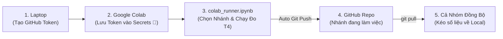

# 📘 Hướng Dẫn Chạy Thực Nghiệm VisionProf Trên Google Colab (Mọi Nhánh)

> **Mục tiêu**: Hướng dẫn quy trình chuẩn hóa chạy đo GPU bằng Deferred CUDA Events trên Google Colab T4, **áp dụng linh hoạt cho bất kỳ nhánh nào** (`main`, `feature/*`, `feat/*`), tự động đồng bộ kết quả về đúng nhánh đó trên GitHub và mở Live Dashboard từ xa qua Ngrok.

---

## 🎯 Tổng Quan Quy Trình Làm Việc Nhóm



---

## 🔑 Bước 1: Tạo GitHub Token (Personal Access Token - Classic)

Do repository là **Private** và thuộc tài khoản cá nhân (`Huu-Tuan13-09`), các thành viên trong nhóm (Collaborator) **phải sử dụng Token loại Classic** (vì GitHub Fine-grained PAT không cho phép ủy quyền repository của tài khoản cá nhân khác cho Collaborator).

1. Truy cập trực tiếp: [github.com/settings/tokens/new](https://github.com/settings/tokens/new)  
   *(Hoặc vào: **Settings** $\rightarrow$ **Developer Settings** $\rightarrow$ **Personal access tokens** $\rightarrow$ **Tokens (classic)** $\rightarrow$ **Generate new token (classic)**)*.
2. Điền thông tin:
   - **Note**: `colab-visionprof-token`
   - **Expiration**: Chọn `30 days` (hoặc `90 days` trong suốt thời gian làm đồ án).
   - **Select scopes**: Tích chọn duy nhất ô **`repo`** (Full control of private repositories - bao gồm clone, pull và push).
3. Bấm **Generate token** ở cuối trang $\rightarrow$ **Copy mã token** (bắt đầu bằng `ghp_...`).

> [!TIP]
> Token Classic với quyền `repo` hoạt động hoàn hảo cho cả Owner lẫn Collaborator, đảm bảo Google Colab có thể clone và tự động push kết quả đo GPU về đúng nhánh của bạn.

---

## ⚙️ Bước 2: Cấu Hình Token Vào Google Colab Secrets

1. Mở trình duyệt: [colab.research.google.com](https://colab.research.google.com).
2. Mở file [`notebooks/colab_runner.ipynb`](../notebooks/colab_runner.ipynb):
   - Chọn tab **Upload** $\rightarrow$ chọn file `colab_runner.ipynb` từ máy tính của bạn.
   - Hoặc chọn tab **GitHub** $\rightarrow$ nhập URL repo `VisionProf` $\rightarrow$ chọn nhánh bạn muốn chạy.
3. Ở **thanh công cụ bên trái của Colab**, bấm vào biểu tượng **chìa khóa (Secrets) 🔑**:
   - Bấm **Add new secret**.
   - **Secret 1 (Bắt buộc để clone & push code)**:
     - **Name**: `VISIONPROF_GITHUB_TOKEN` *(Khuyên dùng tiền tố này để không bị nhầm lẫn với các token của dự án khác trong cùng tài khoản Google; notebook vẫn hỗ trợ fallback `GITHUB_TOKEN` nếu bạn đã lỡ đặt tên cũ)*.
     - **Value**: Dán mã token `ghp_...` vừa tạo ở Bước 1.
     - Gạt công tắc **Notebook access** sang **ON** (màu xanh).
   - **Secret 2 (Tùy chọn - nếu dùng Ngrok Live Dashboard ở Cell 7)**:
     - **Name**: `VISIONPROF_NGROK_AUTHTOKEN`
     - **Value**: Dán mã token lấy từ [dashboard.ngrok.com](https://dashboard.ngrok.com).
     - Gạt công tắc **Notebook access** sang **ON** (màu xanh).

> [!NOTE]
> Việc đặt tên bí danh có tiền tố `VISIONPROF_` giúp quản lý tài nguyên khoa học, đảm bảo không bao giờ bị ghi đè hay dùng nhầm token của dự án khác khi bạn làm việc đa nhiệm trên Google Colab.


---

## 🚀 Bước 3: Chạy Thực Nghiệm Trên Colab GPU T4

### 3.1. Thiết lập phần cứng T4 GPU
Trên menu Colab:
- Chọn **Runtime** $\rightarrow$ **Change runtime type**.
- Mục **Hardware accelerator**: Chọn **T4 GPU** $\rightarrow$ bấm **Save**.

### 3.2. Chạy Thực Nghiệm & Nhập Tên Nhánh Tương Tác (Interactive Input)
Trong notebook [`colab_runner.ipynb`](../notebooks/colab_runner.ipynb):

1. **Chọn nhánh làm việc (Cell 2)**:
   Khi chạy Cell 2, hộp thoại nhập liệu tương tác sẽ xuất hiện ngay dưới cell:
   ```text
   👉 Nhập tên nhánh bạn muốn chạy thực nghiệm (Enter để chọn mặc định 'main'):
   ```
   - Nhập chính xác tên nhánh bạn đang làm việc (ví dụ: `main`, `feature/integrate-tv1-modular`, `feat/model-zoo`, hoặc nhánh tính năng cá nhân).
   - Nhấn **Enter** (nếu để trống và nhấn Enter, notebook sẽ tự động chọn nhánh mặc định `main`).
   - Notebook sẽ tự động dùng `VISIONPROF_GITHUB_TOKEN` (hoặc fallback `GITHUB_TOKEN`) clone repo và checkout/pull đúng nhánh bạn đã nhập.

2. **Xác nhận đẩy kết quả lên GitHub (Cell 6)**:
   Sau khi hoàn tất toàn bộ quá trình đo đạc và sinh biểu đồ ở Cell 4-5, tại Cell 6 sẽ xuất hiện câu hỏi xác nhận:
   ```text
   👉 Xác nhận đẩy kết quả lên nhánh '<BRANCH_NAME>' trên GitHub? (Y/n):
   ```
   - Nhấn **Enter** hoặc gõ `y` để xác nhận đẩy các file kết quả mới (`results/colab_t4/`, `results/analysis/`, `docs/tv1/figures/`, `docs/tv2/figures/`) lên GitHub.
   - Gõ `n` nếu bạn muốn kiểm tra lại trước và chưa muốn push lên remote.


Sau đó bạn có thể bấm **Runtime $\rightarrow$ Run all** (hoặc chạy tuần tự từng cell):

| Cell | Nhiệm vụ | Kết quả mong đợi |
| :---: | :--- | :--- |
| **Cell 1** | Kiểm tra phần cứng (`!nvidia-smi`) | Hiện bảng thông số NVIDIA Tesla T4 16GB VRAM. |
| **Cell 2** | **Nhập nhánh & Clone repo tương tác** | Hộp thoại `input()` yêu cầu nhập nhánh. Tự động dùng token clone repo Private và chuyển vào đúng nhánh đó. |
| **Cell 3** | Cài đặt thư viện dependencies | Cài đủ PyTorch, Torchvision, Ultralytics, Transformers, Pyngrok. |
| **Cell 4** | **Chạy trọn bộ TV1 trên GPU T4**: <br/>• Unit tests CUDA (`pytest`) <br/>• TN1 (`tn1_layer_breakdown.py --device cuda`) <br/>• TN2 (`tn2_validate_profiler.py --device cuda`) <br/>• Phân tích A/B & render 4 biểu đồ báo cáo | • 2 test CUDA pass trực tiếp trên GPU. <br/>• Sinh đầy đủ `results/colab_t4/{model}/TN1/` và `TN2/` cho cả 7 model. <br/>• Cập nhật bảng tổng hợp `summary_colab_t4.csv` và 4 hình tại `docs/tv1/figures/`. |
| **Cell 5** | **Bộ Thực Nghiệm Đánh Giá Linh Hoạt (Interactive Eval)** | Hộp thoại `input()` chọn 1 trong 5 chế độ đo thật 100%: <br/>• **[1] Full Toàn Diện (Khuyên dùng)**: Chạy đủ cả GPU T4 (TN3, TN4, TN5) + CPU Colab (TN3, TN4). <br/>• **[2] GPU T4 Chuyên Sâu**: Chạy trọn vẹn GPU T4 (TN3 8 models, TN4 bs 1/8/32, TN5 FP16). <br/>• **[3] CPU Colab Chuyên Sâu**: Chạy trọn vẹn CPU Colab (TN3 8 models, TN4 bs 1/8/32). <br/>• **[4] Custom Models**: Tùy chọn 1 hoặc nhiều model bất kỳ. <br/>• **[5] Chỉ Phân Tích**: Trích xuất biểu đồ TV1 & TV2 từ dữ liệu sẵn có. |
| **Cell 6** | **Xác nhận & Git Push về đúng nhánh** | Hộp thoại `input()` xác nhận (Y/n). Tự động commit và push toàn bộ số liệu đo thật (`results/colab_t4/`, `results/colab_cpu/`, biểu đồ `docs/`) lên GitHub. |
| **Cell 7** | Mở Live Dashboard qua Ngrok *(Tùy chọn)* | Trả về link công khai `https://xxx.ngrok-free.app` để cả nhóm cùng truy cập xem giao diện đồ thị T4. |
| **Cell 8** | Tải file nén kết quả dự phòng *(Tùy chọn)* | Tự động kích hoạt tải file `.tar.gz` về máy qua trình duyệt. |

---

## 💻 Bước 4: Đồng Bộ Dữ Liệu Về Máy Local Cho Cả Nhóm

Sau khi Cell 6 trên Colab báo `✅ ĐÃ PUSH THÀNH CÔNG LÊN NHÁNH '<BRANCH_NAME>'!`:

Bất kỳ thành viên nào trong nhóm (TV1, TV2, TV3) chỉ cần mở terminal trên máy tính của mình và gõ:

```bash
git pull origin <tên-nhánh-đang-làm-việc>
```

*(Ví dụ: `git pull origin main` hoặc `git pull origin feature/integrate-tv1-modular`)*

Toàn bộ các file kết quả đo GPU T4 mới nhất sẽ lập tức xuất hiện đồng bộ trên máy local:
- `results/colab_t4/*/TN1/bs1_fp32/layers.csv`
- `results/colab_t4/*/TN2/bs1_fp32/tn2_summary.json`
- `results/analysis/TN1/` (báo cáo phân tích đối chiếu CPU vs GPU)
- `results/analysis/TN2/summary_colab_t4.csv`
- `docs/tv1/figures/` (4 hình PNG mới nhất)

---

## 🛠️ Xử Lý Sự Cố Thường Gặp (Troubleshooting)

### 1. Lỗi `Authentication failed` hoặc `Repository not found` ở Cell 2
- **Nguyên nhân**: Chưa thêm `VISIONPROF_GITHUB_TOKEN` (hoặc `GITHUB_TOKEN`) vào Colab Secrets, hoặc chưa bật công tắc **Notebook access**.
- **Xử lý**: Kiểm tra lại Bước 2, đảm bảo Name là `VISIONPROF_GITHUB_TOKEN` (hoặc `GITHUB_TOKEN`) và công tắc đang bật màu xanh.


### 2. Muốn chuyển sang chạy nhánh khác
- **Xử lý**: Chạy lại **Cell 2**, nhập tên nhánh mới vào ô prompt `input()` tương tác. Notebook sẽ tự động fetch và chuyển sang nhánh đó.

### 3. Colab ngắt kết nối giữa chừng (Timeout / GPU disconnect)
- **Xử lý**: Trong các script của dự án (`tn1_layer_breakdown.py`, `tn2_validate_profiler.py`), kết quả được lưu ngay sau từng model. Nếu bị ngắt, bạn chỉ cần bấm chạy lại, script sẽ tiếp tục xử lý các model còn lại.
