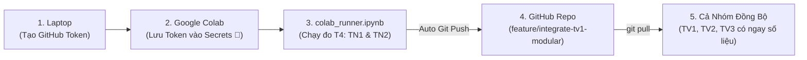

# 📘 Hướng Dẫn Chạy Thực Nghiệm VisionProf Trên Google Colab (GPU T4)

> **Mục tiêu**: Hướng dẫn chi tiết quy trình chạy đo GPU bằng Deferred CUDA Events trên Google Colab T4, tự động đồng bộ kết quả về GitHub cho toàn bộ nhóm (TV1, TV2, TV3) và mở Live Dashboard từ xa qua đường hầm Ngrok.

---

## 🎯 Tổng Quan Quy Trình Làm Việc Nhóm



---

## 🔑 Bước 1: Tạo GitHub Token (Fine-grained PAT)

Vì dự án nằm trên **Repository Private**, Colab cần một Token cá nhân để có thể Clone và Push kết quả về nhánh mà không cần nhập mật khẩu.

1. Đăng nhập GitHub, vào: **Settings** $\rightarrow$ **Developer Settings** (ở góc dưới cùng bên trái).
2. Chọn **Personal access tokens** $\rightarrow$ **Fine-grained tokens** $\rightarrow$ bấm **Generate new token**.
3. Điền các thông số:
   - **Token name**: `colab-visionprof-token`
   - **Expiration**: Chọn `30 days` (hoặc thời hạn làm đồ án).
   - **Repository access**: Chọn **Only select repositories** $\rightarrow$ chọn đúng repo: `Huu-Tuan13-09/VisionProf`.
   - **Permissions** $\rightarrow$ mục **Repository permissions**:
     - `Contents`: Chọn **Read and write** (để clone và push kết quả đo).
4. Bấm **Generate token** $\rightarrow$ **Copy mã token** (có dạng `github_pat_...`).

> [!TIP]
> Token này do tài khoản cá nhân của bạn tạo và chỉ có quyền trên duy nhất repo này trong 30 ngày. Hoàn toàn bảo mật và không ảnh hưởng đến các repo khác.

---

## ⚙️ Bước 2: Cấu Hình Token Vào Google Colab Secrets

1. Mở trình duyệt và truy cập: [colab.research.google.com](https://colab.research.google.com).
2. Mở file [`notebooks/colab_runner.ipynb`](file:///Users/congtri/IT/Dai_Hoc/Xu_ly_du_lieu/VisionProf/notebooks/colab_runner.ipynb):
   - Chọn tab **Upload** (Tải lên) $\rightarrow$ chọn file `notebooks/colab_runner.ipynb` từ máy tính của bạn.
   - Hoặc chọn tab **GitHub** $\rightarrow$ tìm repo `VisionProf` $\rightarrow$ chọn nhánh `feature/integrate-tv1-modular`.
3. Nhìn sang **thanh công cụ bên trái của Colab**, bấm vào **biểu tượng chiếc chìa khóa (Secrets) 🔑**:
   - Bấm **Add new secret**.
   - **Name**: Nhập chính xác `GITHUB_TOKEN`.
   - **Value**: Dán mã token `github_pat_...` vừa tạo ở Bước 1.
   - Gạt công tắc **Notebook access** sang **ON** (màu xanh).

> [!NOTE]
> Secret này được lưu trong tài khoản Google cá nhân của bạn, **không bị lưu vào file notebook hay commit lên Git**. Thành viên khác khi mở notebook cũng không thể thấy token của bạn.

---

## 🚀 Bước 3: Chạy Thực Nghiệm Trên Colab GPU T4

### 3.1. Thiết lập phần cứng T4 GPU
Trên thanh menu trên cùng của Colab:
- Chọn **Runtime** $\rightarrow$ **Change runtime type** (Thay đổi loại phần cứng).
- Tại mục **Hardware accelerator**: Chọn **T4 GPU**.
- Bấm **Save**.

### 3.2. Thực thi các Cell trong Notebook
Bấm **Runtime $\rightarrow$ Run all** (hoặc bấm chạy tuần tự từng cell):

| Cell | Nhiệm vụ | Kết quả mong đợi |
| :---: | :--- | :--- |
| **Cell 1** | Kiểm tra phần cứng (`!nvidia-smi`) | Hiện bảng thông số NVIDIA Tesla T4 16GB VRAM. |
| **Cell 2** | Clone repo Private & Checkout nhánh | Tự động dùng `GITHUB_TOKEN` để clone repo vào `/content/VisionProf` và chuyển sang nhánh `feature/integrate-tv1-modular`. |
| **Cell 3** | Cài đặt thư viện dependencies | Cài đủ PyTorch, Torchvision, Ultralytics, Transformers, Pyngrok. |
| **Cell 4** | **Chạy trọn bộ TV1 trên GPU T4**: <br/>• Unit tests CUDA (`pytest`) <br/>• TN1 (`tn1_layer_breakdown.py --device cuda`) <br/>• TN2 (`tn2_validate_profiler.py --device cuda`) <br/>• Phân tích A/B & render 4 biểu đồ báo cáo | • 2 test CUDA pass trực tiếp trên GPU. <br/>• Sinh đầy đủ `results/colab_t4/{model}/TN1/` và `TN2/` cho cả 7 model. <br/>• Cập nhật bảng tổng hợp `summary_colab_t4.csv` và 4 hình tại `docs/tv1/figures/`. |
| **Cell 5** | Chạy thực nghiệm TV2 / TV3 mẫu | Đo baseline 8 model (TN3). |
| **Cell 6** | **Tự động Git Push về GitHub** | Colab tự động `git commit` và `git push` các file kết quả mới lên nhánh `feature/integrate-tv1-modular`. |
| **Cell 7** | Mở Live Dashboard qua Ngrok *(Tùy chọn)* | Trả về một đường link `https://xxx.ngrok-free.app` để cả nhóm cùng truy cập xem giao diện. |

---

## 💻 Bước 4: Đồng Bộ Dữ Liệu Về Máy Local Cho Cả Nhóm

Sau khi Cell 6 trên Colab báo `✅ ĐÃ PUSH THÀNH CÔNG LÊN GITHUB!`:

Bất kỳ thành viên nào trong nhóm (TV1, TV2, TV3) chỉ cần mở terminal trên máy tính của mình và gõ:

```bash
git pull origin feature/integrate-tv1-modular
```

Toàn bộ các file kết quả mới từ GPU T4 sẽ xuất hiện ngay lập tức trên máy local:
- `results/colab_t4/*/TN1/bs1_fp32/layers.csv`
- `results/colab_t4/*/TN2/bs1_fp32/tn2_summary.json`
- `results/analysis/TN1/` (báo cáo phân tích so sánh CPU vs GPU)
- `results/analysis/TN2/summary_colab_t4.csv`
- `docs/tv1/figures/` (4 hình PNG mới nhất)

---

## 🛠️ Xử Lý Sự Cố Thường Gặp (Troubleshooting)

### 1. Lỗi `Authentication failed` hoặc `Repository not found` ở Cell 2
- **Nguyên nhân**: Chưa thêm `GITHUB_TOKEN` vào Colab Secrets, hoặc token chưa được bật công tắc **Notebook access**.
- **Xử lý**: Kiểm tra lại Bước 2, đảm bảo Name là `GITHUB_TOKEN` và công tắc đang bật màu xanh.

### 2. Colab ngắt kết nối giữa chừng (Timeout / GPU disconnect)
- **Nguyên nhân**: Colab Free tự động ngắt nếu không tương tác hoặc chạy quá hạn mức.
- **Xử lý**: Trong các script của dự án (`tn1_layer_breakdown.py`, `tn2_validate_profiler.py`), kết quả được lưu ngay sau từng model. Nếu bị ngắt, bạn chỉ cần bấm chạy lại, script sẽ tiếp tục xử lý các model còn lại.

### 3. Đã push lên nhánh nhưng chưa vào `main`
- **Quy trình chuẩn**: Tuyệt đối **không push thẳng vào `main`**. Sau khi Colab push lên `feature/integrate-tv1-modular`, bạn chỉ cần lên giao diện GitHub bấm **New Pull Request** để nhóm cùng review và merge vào `main`.
