# Kế Hoạch Tích Hợp Toàn Diện: Nhánh `tv1-layer` Vào Kiến Trúc Modular `main` (VisionProf v2.0)

> **Tài liệu tham chiếu chuẩn:** [`PROJECT_PLAN.md`](../../PROJECT_PLAN.md), [`agent-rules/`](../../agent-rules/), [`TECHNICAL_SPECIFICATION.md`](../../TECHNICAL_SPECIFICATION.md)  
> **Trạng thái:** Bản rà soát chuyên sâu v2.0 — Đã bao quát 12/12 rủi ro kỹ thuật ngầm  
> **Nguyên tắc cốt lõi:** *"Cấu trúc chuẩn theo `main`, Linh hồn khoa học theo `tv1-layer`"* (Modular Structure + Scientific Rigor)

---

## 1. Bối Cảnh & Phân Tích Hiện Trạng

### 1.1. Bản chất sự phân kỳ giữa hai nhánh
* **Nhánh `main`:**
  * Được kiến trúc lại toàn diện thành mô hình **Canonical Flat Modular v2.0** theo [`PROJECT_PLAN.md`](../../PROJECT_PLAN.md) (Mục 8.2).
  * Phân rã hệ thống thành các module ranh giới rõ ràng: `src/core/`, `src/layer/`, `src/model/`, `src/zoo/`, `src/phase/`, `src/analyzer/`, `src/dashboard/`.
  * Thiết lập bộ linter chuẩn tự động [`scripts/verify_rules.py`](../../scripts/verify_rules.py) khống chế nghiêm ngặt: giới hạn $\le 300$ dòng/file (Hard limit), 100% type hints, cấm bare `print()`.
  * *Hạn chế hiện tại:* Code mức Layer tại `src/layer/` mới dừng lại ở mức khung sườn (scaffold), chưa có kết quả thực nghiệm thực tế và chưa có tài liệu/slide của TV1.
* **Nhánh `tv1-layer`:**
  * Phân nhánh từ commit cũ `f9abffe` (trước khi có Modular v2.0).
  * TV1 (bạn Quân) đã giải quyết triệt để các bài toán khoa học thực tế: Deferred CUDA Events, xử lý module gọi nhiều lần (`call_index`), đo và trừ `timer_bias` trên CPU, tránh GPU queue starvation, tách biệt activation memory vs process RSS, tính FLOPs & Roofline chuẩn xác.
  * Đã chạy thực nghiệm thực tế 100% cho 7 mô hình trên cả Google Colab T4 và CPU Laptop.
  * Đã hoàn thiện toàn bộ báo cáo chuyên sâu (`docs/tv1/BAO_CAO_TV1.md`), slide thuyết trình (`docs/tv1/SLIDES_TV1.md`), biểu đồ (`docs/tv1/figures/`).
  * *Hạn chế hiện tại:* Code vẫn viết theo cấu trúc cũ (sửa trực tiếp `src/collector.py` phình to 1.261 dòng, đặt các file mới `src/flops.py`, `src/layer_plugin.py`, `src/hw_specs.py`, `src/layer_analysis.py` trực tiếp ở thư mục gốc `src/`).

### 1.2. Phản biện phương án: "Điều chỉnh `main` theo `tv1-layer`"
| Tiêu chí | Nếu ép `main` theo `tv1-layer` (Layout phẳng v1.0) | Giải pháp tối ưu: Hợp nhất vào Modular v2.0 |
| :--- | :--- | :--- |
| **Tính toàn vẹn hệ thống** | ❌ **Phá vỡ hệ thống**: Làm gãy kết nối với phần việc của TV2 (`src/zoo/`, `src/model/`, `run_experiment.py`) và TV3 (`src/phase/`, `src/analyzer/`). | ✅ **Bảo toàn 100%**: 3 thành viên tích hợp mượt mà qua Public Interfaces (`ProfilerPlugin`, `ModelAdapter`). |
| **Quy chuẩn mã nguồn** | ❌ **Vi phạm nặng**: `collector.py` dài 1.261 dòng, `verify_rules.py` báo lỗi, mã nguồn bị đánh giá thấp về mặt kỹ thuật phần mềm. | ✅ **Chuẩn mực cao**: Mọi file $\le 250$ dòng, Single Responsibility Principle, 100% type hints, `verify_rules.py` pass xanh. |
| **Thành quả của TV1** | ⚠️ Giữ nguyên nhưng cô lập, khó kết nối với Dashboard chung và Engine chẩn đoán 19 rules. | ✅ **Nâng tầm thành quả**: Tích hợp trực tiếp vào Tab 3 của Dashboard 7 tabs, cung cấp `layers.csv` chuẩn cho TV3 phân tích chẩn đoán. |

---

## 2. Ma Trận 12 Rủi Ro Tiềm Ẩn & Biện Pháp Phòng Ngừa Triệt Để

Bảng đối soát chi tiết toàn bộ các bẫy kỹ thuật (từ Git, Hệ điều hành, PyTorch runtime cho đến Schema dữ liệu):

| # | Rủi ro tiềm ẩn | Mức độ | Cơ chế phát sinh | Biện pháp xử lý triệt để |
| :-: | :--- | :-: | :--- | :--- |
| **R1** | **Xung đột Git trực tiếp (Merge Conflict)** | **Cao** | Cả `main` và `tv1-layer` đều tạo mới `tests/test_layer_profiler.py` và sửa `requirements.txt`. | **Không dùng `git merge` mù quáng**. Tạo branch tích hợp `feature/integrate-tv1-modular`, giữ file test của `main` và đổi tên test TV1 thành `tests/test_layer_scientific_accuracy.py`. Merge thủ công `requirements.txt`. |
| **R2** | **Lệch Data Schema `layers.csv` giữa TV1 và TV3** | **Nghiêm trọng** | TV3 đọc `layers.csv` để chẩn đoán luật `RB-04`, `RD-05` (tính ms/GFLOP). Nếu TV1 đổi tên hoặc thứ tự cột, TV3 sẽ crash. | Khóa cứng 7 cột đầu tiên theo đúng hợp đồng Mục 8.1 ③ trong `PROJECT_PLAN.md`: `iteration,layer_name,layer_type,time_ms,activation_mb,flops,params`. Các cột mở rộng của TV1 (`call_index`, `raw_time_ms`,...) xếp từ cột thứ 8 trở đi. |
| **R3** | **Lệch Interface Name trong Model Zoo (`get_adapter`)** | **Trung bình** | `tv1_common.py` import `get_adapter(name)`, trong khi `src/zoo/__init__.py` trên `main` đặt tên là `get_model_adapter(name)`. | Bổ sung alias `get_adapter = get_model_adapter` vào `src/zoo/__init__.py` để tương thích ngược 100%. |
| **R4** | **Vượt giới hạn 300 dòng/file khi gộp FLOPs & Roofline** | **Cao** | `src/flops.py` của TV1 đã dài 239 dòng, nếu gộp cả code cũ của `main` sẽ vượt ngưỡng 300 dòng. | Tách đôi theo đúng SRP: `src/layer/flops.py` (ước tính FLOPs & bytes qua `FlopCounterMode`) và `src/layer/roofline.py` (phân tích % hiệu suất, attainable GFLOPs và memory/compute bound). Cả 2 file đều $< 200$ dòng. |
| **R5** | **AST Type Hint Linter bắt lỗi Closure Functions** | **Trung bình** | Trong `src/flops.py` và `src/layer_plugin.py`, các hàm closure lồng bên trong (`make_hook`, `capture`) không có dấu gạch dưới `_`, bị `verify_rules.py` coi là public function thiếu type hints. | Thêm tiền tố `_` cho toàn bộ internal closures (`_make_hook`, `_capture`) và bổ sung đầy đủ return type annotation `-> None`. |
| **R6** | **Chênh lệch phiên bản Streamlit** | **Thấp** | `main` dùng `streamlit>=1.28.0`, còn code dashboard của TV1 dùng tính năng `streamlit>=1.46.0`. | Cập nhật `streamlit>=1.46.0` trong `requirements.txt`. |
| **R7** | **Đồng bộ ngầm CPU-GPU trong BERT (`attention_mask`)** | **Nghiêm trọng** | HuggingFace kiểm tra `attention_mask` bằng lệnh có điều kiện CPU ngầm, ép gọi `cudaStreamSynchronize()` giữa chừng, làm sai lệch thời gian đo GPU của TV1. | Cập nhật `DistilBERTAdapter` & `BERTBaseAdapter`: Khi chạy profiling không có padding, input chỉ truyền `{"input_ids": ids}` để GPU chạy thẳng mạch không bị ngắt quãng. |
| **R8** | **Lệch Case-Sensitivity trên Linux Colab (`TN1` vs `tn1`)** | **Cao** | Hệ điều hành Linux (Colab/CI) phân biệt chữ hoa/thường: `results/colab_t4/resnet50/TN1/` viết hoa, nhưng `sanitize_name` trong `paths.py` lại chuyển thành `tn1`. `tab_layer.py` tìm `TN1` sẽ không thấy nếu bị lowercase. | Cập nhật `src/core/paths.py` và `tab_layer.py`: Chuẩn hóa giữ nguyên định dạng `TN1`, `TN2`... cho thư mục thực nghiệm, đồng thời bổ sung cơ chế fallback tra cứu case-insensitive. |
| **R9** | **Lệch định danh thiết bị (`colab_t4` vs `cuda`) trong `detect_hardware`** | **Cao** | `run_experiment.py` truyền `--device colab_t4`, nhưng `detect_hardware()` của TV1 chỉ kiểm tra `device.startswith("cuda")`. Nếu nhận `colab_t4`, nó coi là CPU và gán nhầm thông số! | Nâng cấp `detect_hardware(device)` trong `src/layer/hw_specs.py` để nhận diện cả 2 dạng: trực tiếp (`colab_t4`, `colab_cpu`, `cpu_laptop`) và qua PyTorch (`cuda`, `cuda:0`, `cpu`). |
| **R10** | **Lỗi tuần tự hóa JSON với kiểu dữ liệu NumPy (`_NumpyEncoder`)** | **Trung bình** | `layer_meta.json` chứa các trường `np.int64`, `np.float64`, `np.bool_`. Hàm `json.dump` chuẩn của Python sẽ quăng ngoại lệ `TypeError`. | Đưa class `_NumpyEncoder` chuẩn vào `src/layer/plugin.py` để serialize an toàn khi lưu `layer_meta.json`. |
| **R11** | **Mã cũ gọi import di sản từ `src.collector`** | **Trung bình** | Nếu có script hoặc thành viên khác import `from src.collector import LayerProfiler`, việc để file cũ v1.0 sẽ chạy nhầm code lỗi. | Bổ sung facade re-export tại cuối file di sản `src/collector.py`: `from src.layer.plugin import LayerProfilerPlugin as LayerProfiler`. |
| **R12** | **Nạp mô hình YOLO offline không phụ thuộc weights mạng** | **Trung bình** | `YOLOv8nAdapter` gọi `YOLO("yolov8n.pt")` cố tải weights từ mạng, gây treo nếu chạy môi trường cách ly hoặc mất mạng. | Sử dụng khởi tạo kiến trúc qua cấu trúc YAML `YOLO("yolov8n.yaml").model` (hoặc fallback có sẵn), đảm bảo benchmark không phụ thuộc vào tải mạng từ bên ngoài. |

---

## 3. Kiến Trúc Tích Hợp Chi Tiết (Module Mapping 1-1)

Sơ đồ chuyển dịch mã nguồn từ nhánh `tv1-layer` vào cây thư mục Modular v2.0 của `main`:

```mermaid
graph TD
    subgraph TV1_Branch["Nhánh tv1-layer (Mã nguồn & Dữ liệu thực tế)"]
        TV1_COL["src/collector.py<br/>(LIFO stack, CUDA events, timer bias)"]
        TV1_FLP["src/flops.py<br/>(FlopCounterMode, Attention, Roofline)"]
        TV1_HW["src/hw_specs.py<br/>(Colab T4 & Laptop CPU specs)"]
        TV1_PLG["src/layer_plugin.py<br/>(LayerPlugin save 3 files)"]
        TV1_ANA["src/layer_analysis.py<br/>(Top-10, type share, compare)"]
        TV1_UI["src/dashboard_tabs/layer_tab.py<br/>(Roofline & Breakdown UI)"]
        TV1_EXP["experiments/*<br/>(tn1, tn2, tv1_figures, demo)"]
        TV1_DOC["docs/tv1/*<br/>(Báo cáo, slides, figures)"]
        TV1_RES["results/*<br/>(Số liệu TN1, TN2 Colab T4 & Laptop)"]
        TV1_TST["tests/test_layer_*.py<br/>(22 tests chuẩn xác khoa học)"]
    end

    subgraph Main_Modular["Nhánh main (Cấu trúc Canonical Modular v2.0)"]
        M_EVT["src/layer/events.py<br/>(DeferredCudaDispatcher + prefill)"]
        M_TIM["src/layer/timer.py & overhead.py<br/>(CPUTimer + timer bias)"]
        M_FLP["src/layer/flops.py<br/>(FlopsCalculator)"]
        M_ROOF["src/layer/roofline.py<br/>(add_efficiency, Roofline bounds)"]
        M_HW["src/layer/hw_specs.py<br/>(HardwareSpec & detect_hardware)"]
        M_PLG["src/layer/plugin.py<br/>(LayerProfilerPlugin : ProfilerPlugin)"]
        M_ANA["src/layer/analysis.py<br/>(Layer hotspot & type analyzer)"]
        M_DASH["src/dashboard/tabs/tab_layer.py<br/>(Tab 3 chính thức trong 7 tabs)"]
        M_EXP["experiments/*<br/>(Giữ nguyên kịch bản chạy độc lập)"]
        M_DOC["docs/tv1/*<br/>(Báo cáo chương 2,3,4,6,7 + Slides)"]
        M_RES["results/*<br/>(Kho số liệu chuẩn hóa)"]
        M_TST["tests/test_layer_scientific_accuracy.py<br/>(Bộ test khoa học)"]
    end

    TV1_COL -->|CUDA Events + queue prefill| M_EVT
    TV1_COL -->|estimate_timer_bias| M_TIM
    TV1_FLP -->|FLOPs counting| M_FLP
    TV1_FLP -->|Roofline efficiency| M_ROOF
    TV1_HW -->|Specs logic| M_HW
    TV1_PLG -->|Chuẩn hóa interface| M_PLG
    TV1_ANA -->|Di chuyển module| M_ANA
    TV1_UI -->|Tích hợp Tab 3| M_DASH
    TV1_EXP -->|Cập nhật import src.layer| M_EXP
    TV1_DOC -->|Bảo toàn 100%| M_DOC
    TV1_RES -->|Bảo toàn 100%| M_RES
    TV1_TST -->|Đổi tên tránh xung đột| M_TST
```



---

## 4. Kế Hoạch Triển Khai Chi Tiết (5 Giai Đoạn)

### Giai đoạn 1: Chuẩn bị phân nhánh an toàn & Tiếp nhận tài sản độc lập
* [ ] **1.1. Tạo nhánh tích hợp mới từ `main`**:
  ```bash
  git checkout main
  git pull origin main
  git checkout -b feature/integrate-tv1-modular
  ```
* [ ] **1.2. Tiếp nhận thư mục Báo cáo & Slides (`docs/tv1/`)**:
  * Sao chép toàn bộ `docs/tv1/BAO_CAO_TV1.md`, `README_TV1.md`, `SLIDES_TV1.md` và thư mục `docs/tv1/figures/`.
  * Không chỉnh sửa nội dung văn phong học thuật của TV1.
* [ ] **1.3. Tiếp nhận toàn bộ kho dữ liệu thực nghiệm (`results/`)**:
  * Sao chép `results/colab_t4/` và `results/cpu_laptop/` (chứa các file `layers.csv`, `layers_summary.csv`, `layer_meta.json` của cả 7 models).
  * Sao chép `results/analysis/TN1/` và `results/analysis/TN2/` (chứa các báo cáo phân tích Markdown và bảng so sánh CPU-GPU).
* [ ] **1.4. Tiếp nhận kịch bản thực nghiệm (`experiments/`)**:
  * Đưa `tn1_layer_breakdown.py`, `tn2_validate_profiler.py`, `demo_layer_profiler.py`, `tv1_figures.py`, `tv1_common.py` vào thư mục `experiments/`.

---

### Giai đoạn 2: Cập nhật & Tái cấu trúc Module `src/layer/`
* [ ] **2.1. Cập nhật `src/layer/events.py`**:
  * Nâng cấp class `DeferredCudaDispatcher`:
    * Hỗ trợ lưu trữ LIFO stack theo `(layer_name, call_index)`.
    * Tích hợp cơ chế kiểm tra và duy trì `prefill_ok` (đảm bảo GPU stream không bị ngắt quãng giữa các kernel).
    * Phương thức `synchronize_and_collect()` trả về thời gian chính xác của từng lần gọi layer.
  * Giới hạn kích thước file: $\le 150$ dòng.
* [ ] **2.2. Cập nhật `src/layer/timer.py` & `src/layer/overhead.py`**:
  * Đưa hàm `estimate_timer_bias(device: str) -> float` vào `src/layer/overhead.py` để đo độ trễ của chính lời gọi bấm giờ trên CPU.
  * Bổ sung cơ chế tự động trừ bias trong `CPUTimer` khi đo trên CPU.
  * Giới hạn kích thước file: $\le 120$ dòng.
* [ ] **2.3. Cập nhật `src/layer/hw_specs.py`** (Giải quyết R9):
  * Hợp nhất dataclass `HardwareSpec` hoàn chỉnh từ `tv1-layer` (hỗ trợ `peak_gflops()`, `ridge_point()`, `to_dict()`).
  * Cập nhật hàm `detect_hardware(device: str) -> HardwareSpec` hỗ trợ nhận diện tự động Google Colab T4 (`colab_t4`, `cuda`) và laptop CPU (`colab_cpu`, `cpu_laptop`, `cpu`).
  * Giới hạn kích thước file: $\le 130$ dòng.
* [ ] **2.4. Cập nhật `src/layer/flops.py` & Tạo mới `src/layer/roofline.py`** (Giải quyết R4, R5):
  * Trong `src/layer/flops.py`:
    * Đưa vào các công thức tính FLOPs chuẩn qua `FlopCounterMode`, hỗ trợ custom mapping cho `nn.MultiheadAttention` và `scaled_dot_product_attention`.
    * Bổ sung bảng tra cứu `_ANALYTIC_FLOPS_PER_ELEMENT` cho các layer chuẩn hóa (BatchNorm, LayerNorm, ReLU).
    * Hàm `analyze_layers(model, inputs) -> pd.DataFrame` đo FLOPs và số byte đọc/ghi.
    * Đặt tên các hàm lồng có tiền tố `_` (`_make_hook`) kèm type hints 100% để vượt qua `verify_rules.py`.
  * Trong `src/layer/roofline.py`:
    * Cung cấp hàm `add_efficiency(layer_times, analysis, spec, precision) -> pd.DataFrame` tính toán: `gflops`, `achieved_gflops`, `attainable_gflops`, `efficiency_pct`, `bound` ("compute" hoặc "memory").
  * Đảm bảo cả hai file đều $\le 200$ dòng.
* [ ] **2.5. Tạo mới `src/layer/analysis.py`**:
  * Chuyển mã nguồn từ `src/layer_analysis.py` sang `src/layer/analysis.py`.
  * Cung cấp các hàm: `load_layers()`, `top_k_layers()`, `type_share()`, `compare_top_k()`, `compare_type_share()`, `to_markdown()`.
  * Giới hạn kích thước file: $\le 120$ dòng.
* [ ] **2.6. Chuẩn hóa `src/layer/plugin.py`** (Giải quyết R2, R5, R10):
  * Class `LayerProfilerPlugin` kế thừa đúng `ProfilerPlugin` từ `src.core.interfaces`.
  * Thực thi chuẩn các phương thức: `attach(model, device)`, `start(iteration)`, `stop()`, `detach()`.
  * Phương thức `save(out_dir: Path)` xuất đầy đủ 3 artifacts:
    1. `layers.csv`: Đúng schema 7 cột bắt buộc ở đầu theo `PROJECT_PLAN.md` (Mục 8.1 ③), kèm các cột chi tiết mở rộng.
    2. `layers_summary.csv`: Tổng hợp hiệu suất Roofline, GFLOP/s và giới hạn phần cứng.
    3. `layer_meta.json`: Sử dụng `_NumpyEncoder` để tránh crash serialization.
  * Giới hạn kích thước file: $\le 220$ dòng.
* [ ] **2.7. Cập nhật `src/layer/__init__.py` & Re-export tại `src/collector.py`** (Giải quyết R11):
  * Re-export đầy đủ các class và function công khai:
    ```python
    from src.layer.plugin import LayerProfilerPlugin, profile_layers
    from src.layer.flops import FlopsCalculator, analyze_layers, model_total_flops
    from src.layer.roofline import add_efficiency
    from src.layer.hw_specs import HardwareSpec, detect_hardware
    from src.layer.analysis import top_k_layers, type_share, compare_top_k
    ```
  * Thêm alias vào cuối `src/collector.py`: `LayerProfiler = LayerProfilerPlugin`.

---

### Giai đoạn 3: Nâng cấp Tab Dashboard & Tương thích Runner & Adapters
* [ ] **3.1. Hoàn thiện Tab 3 tại `src/dashboard/tabs/tab_layer.py`** (Giải quyết R8):
  * Thay thế placeholder hiện tại bằng mã nguồn hoàn chỉnh từ `src/dashboard_tabs/layer_tab.py` của TV1.
  * Hỗ trợ tìm kiếm kết quả linh hoạt không phân biệt hoa/thường (`TN1` và `tn1`).
  * Cung cấp các chế độ hiển thị chuyên sâu:
    * Bảng chọn model và thiết bị (Colab T4 vs Laptop CPU).
    * Biểu đồ thanh Top-10 layer tốn thời gian nhất.
    * Biểu đồ tròn/thanh phân bố tỷ trọng thời gian theo loại layer (`layer_type`).
    * Biểu đồ tương tác Roofline Model (Plotly) hiển thị vị trí các layer so với đường trần phần cứng.
    * Bảng đối chiếu chéo thời gian và speedup giữa CPU và GPU.
  * Giới hạn kích thước file: $\le 280$ dòng.
* [ ] **3.2. Cập nhật Model Zoo tại `src/zoo/__init__.py` & NLP Adapter** (Giải quyết R3, R7, R12):
  * Thêm alias: `get_adapter = get_model_adapter` trong `src/zoo/__init__.py`.
  * Cập nhật `src/zoo/nlp.py`: Hỗ trợ cờ đo không truyền `attention_mask` khi input không padding để triệt tiêu hidden CUDA sync.
* [ ] **3.3. Cập nhật Đường dẫn tại `src/core/paths.py`** (Giải quyết R8):
  * Đảm bảo hàm `build_result_path` chuẩn hóa token thực nghiệm viết hoa `TN1`, `TN2`... đúng như cấu trúc thư mục đã ghi trên đĩa.
* [ ] **3.4. Hiệu chỉnh Imports trong thư mục `experiments/`**:
  * Cập nhật các import trong `experiments/tv1_common.py`, `tn1_layer_breakdown.py`, `tn2_validate_profiler.py`, `tv1_figures.py` trỏ vào `src.layer.*`.

---

### Giai đoạn 4: Hợp nhất Dependencies & Kiểm Thử Toàn Diện
* [ ] **4.1. Hợp nhất `requirements.txt`** (Giải quyết R1, R6):
  * Giữ nguyên các gói của `main`: `xgboost>=2.0.0`, `datasets>=2.14.0`, `pyngrok>=7.0.0`.
  * Cập nhật và bổ sung các gói của `tv1-layer`: `transformers>=4.40.0`, `matplotlib>=3.8.0`, `streamlit>=1.46.0`.
* [ ] **4.2. Hợp nhất Bộ Unit Tests** (Giải quyết R1):
  * Giữ nguyên `tests/test_layer_profiler.py` của `main` (kiểm tra Zero-Config leaf hooks, non-torch bypass).
  * Tạo mới `tests/test_layer_scientific_accuracy.py` (chuyển từ test của TV1, kiểm chứng 10 tính chất khoa học: GPU event timing, module reentrancy, activation vs RSS, ReLU inplace, calibrate overhead).
  * Tạo mới `tests/test_layer_flops_roofline.py` (chuyển từ `test_layer_flops_plugin.py`).
  * Cập nhật các câu lệnh import trong test trỏ về `src.layer.*`.

---

### Giai đoạn 5: Thẩm Định Quy Chuẩn & Tích Hợp Vào `main`
* [ ] **5.1. Thẩm định quy chuẩn tự động (Rule Verification)**:
  * Chạy công cụ kiểm tra bắt buộc:
    ```bash
    python3 scripts/verify_rules.py
    ```
  * **Tiêu chí nghiệm thu:** Kết quả hiển thị:
    ```
    ============================================================
    🔍 VISIONPROF — KIỂM TRA TUÂN THỦ QUY TẮC MÃ NGUỒN
    ============================================================
    ✅ TẤT CẢ QUY TẮC ĐƯỢC TUÂN THỦ HOÀN TOÀN!
    ```
    (Exit code 0, không có file nào $> 300$ dòng, 100% type hints, không bare print).
* [ ] **5.2. Chạy thử nghiệm CLI Runner tổng thể**:
  * Chạy thử lệnh tích hợp TV1 + TV2 trên 1 model nhẹ:
    ```bash
    python3 scripts/run_experiment.py --model mlp --device colab_cpu --profilers layer --warmup 2 --measure 5
    ```
  * Kiểm tra file `results/colab_cpu/mlp/TN3/bs1_fp32/layers.csv` được sinh ra chính xác.
* [ ] **5.3. Mở Pull Request & Merge**:
  * Commit các thay đổi theo chuẩn Conventional Commits:
    ```bash
    git add .
    git commit -m "feat(layer): integrate tv1 scientific implementation into modular architecture"
    ```
  * Rebase trên `main` mới nhất và tạo Pull Request (Squash and Merge) để giữ lịch sử Git tuyến tính và sạch sẽ.

---

## 5. Bảng Đối Soát Nghiệm Thu (Acceptance Checklist)

Trước khi đóng branch tích hợp, đối soát đầy đủ các tiêu chí sau:

- [ ] Toàn bộ thư mục `docs/tv1/` và dữ liệu `results/` đã có mặt đầy đủ trên nhánh tích hợp.
- [ ] Không có file mới nào trong `src/` hoặc `tests/` vượt quá 300 dòng code.
- [ ] Mọi public function/method trong `src/layer/` đều có type hints 100%.
- [ ] Không còn lệnh `print()` debug nào trong các module lõi `src/layer/`.
- [ ] Không xảy ra lỗi serialization JSON khi ghi `layer_meta.json`.
- [ ] Đường dẫn `results/` tương thích 100% trên cả Linux (Colab) và macOS/Windows.
- [ ] Kịch bản chạy thực nghiệm trong `experiments/` chạy thông suốt với import mới.
- [ ] Streamlit Dashboard mở Tab 3 hiển thị đầy đủ biểu đồ Roofline và số liệu TN1/TN2.
- [ ] Lệnh `python3 scripts/verify_rules.py` trả về exit code 0.
- [ ] Test suite trong `tests/` vượt qua 100% bài kiểm tra.
