# Trình bày slide 5–14 · Võ Trần Anh Quân

> Nghiên cứu liên quan + mức Layer (CH1, CH2) · 10 slide · khoảng 9 phút.
> Mỗi slide có 3 phần: **Ý chính** (nhớ 1 câu) · **Hiểu** (để trả lời khi bị hỏi) · **Nói** (nhìn chữ trên slide mà nói theo).

## Tổng quan trong 1 phút

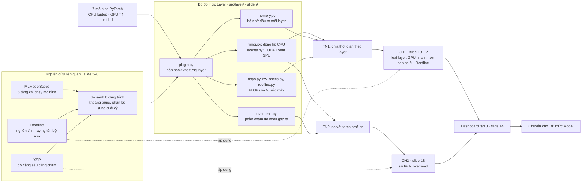

Đọc sơ đồ từ trái sang phải:
- **Bên trái** là 3 bài báo đi trước, dẫn tới khoảng trống nhóm muốn lấp.
- **Ở giữa** là bộ đo bạn viết trong `src/layer/`: `plugin.py` gắn vào mô hình, rồi gọi các phần đo thời gian, bộ nhớ, FLOPs và overhead.
- **Bên phải** là 2 thí nghiệm. TN1 trả lời CH1, TN2 trả lời CH2, rồi đưa lên dashboard.
- **Nét đứt** là chỗ bài báo được áp dụng: Roofline dùng ở slide 12, XSP dùng ở slide 13.

- **VisionProf** gắn bộ đo vào mô hình PyTorch có sẵn (qua forward hook, không sửa mô hình) để biết thời gian đi vào đâu. Nhóm đo 3 mức: **Layer (bạn)**, Model (Trí), Giai đoạn (Tuân).
- **Phần của bạn trả lời 2 câu:**
  - **CH1:** thời gian dồn vào loại layer nào, CPU khác GPU ra sao (thí nghiệm **TN1**).
  - **CH2:** công cụ đo có đúng không (thí nghiệm **TN2**).
- **Máy đo:** CPU là laptop x86 của bạn, GPU là Tesla T4 trên Colab. Mọi số đo ở batch 1, FP32.
- **Mạch nói:**
  - 3 bài báo đi trước (5–7);
  - nhóm khác họ ở đâu (8);
  - cách đo trên GPU (9);
  - kết quả CH1 (10–12), kết quả CH2 (13);
  - dashboard (14), rồi chuyển cho Trí.
- **Mỗi bài báo móc sang một slide sau:**
  - Roofline sang **slide 12**;
  - XSP sang **slide 13**.

---

## Slide 5 · MLModelScope: 5 tầng · ~60 giây

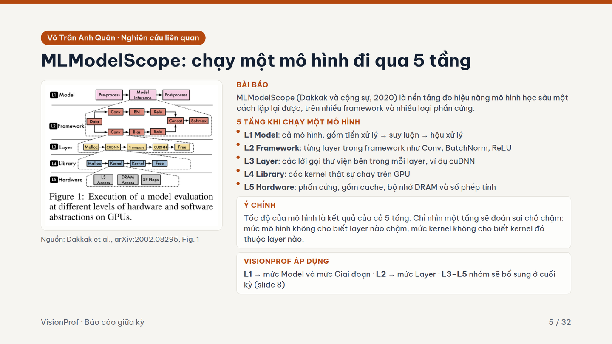

**Ý chính:** chạy một mô hình đi qua 5 tầng; chỉ nhìn một tầng thì đoán sai chỗ chậm.

**Hiểu:**
- **L1** là cả mô hình (tiền xử lý → suy luận → hậu xử lý).
- **L2** là từng layer PyTorch (Conv, BatchNorm, ReLU).
- **L3** là lời gọi thư viện bên trong layer (cuDNN, Malloc).
- **L4** là kernel chạy trên GPU.
- **L5** là phần cứng (cache, DRAM, phép tính).
- Giữa kỳ nhóm đã làm **L1** (mức Model, Giai đoạn) và **L2** (mức Layer). **L3–L5** (cuDNN, kernel, phần cứng) nhóm sẽ bổ sung ở cuối kỳ.
- Nếu thầy hỏi "có đo cuDNN, kernel không?": "Dạ giữa kỳ nhóm em đo tới từng layer PyTorch, phần đo sâu tới kernel nhóm em sẽ bổ sung ở cuối kỳ."

**Nói:**
> Bài đầu tiên là MLModelScope, năm 2020. Bài chia việc chạy một mô hình thành 5 tầng: L1 là cả mô hình, L2 là từng layer như Conv, BatchNorm, L3 là lời gọi thư viện như cuDNN, L4 là kernel GPU, L5 là phần cứng. Ý chính: tốc độ là kết quả của cả 5 tầng. Nhìn mức mô hình thì không biết layer nào chậm; nhìn mức kernel thì không biết kernel đó thuộc layer nào. Nhóm em đo L1 ở mức Model và Giai đoạn, L2 ở mức Layer; các tầng L3 đến L5 nhóm sẽ bổ sung ở cuối kỳ, em nói thêm ở slide 8.

## Slide 6 · Roofline · ~60 giây

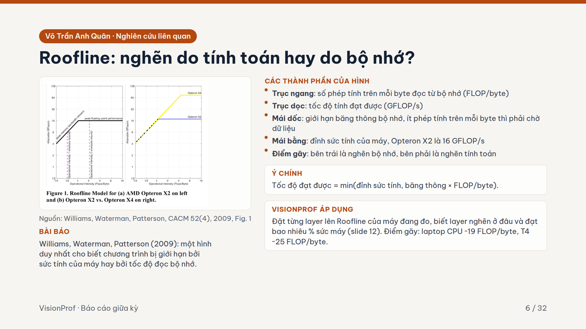

**Ý chính:** một hình cho biết phép tính bị chặn bởi sức tính của máy hay bởi tốc độ đọc bộ nhớ.

**Hiểu:**
- **Trục ngang** là FLOP/byte: mỗi byte đọc vào thì tính được bao nhiêu phép. **Trục dọc** là tốc độ tính đạt được.
- **Mái dốc** là giới hạn bộ nhớ: tính ít, đọc nhiều thì phải chờ dữ liệu. **Mái bằng** là sức tính tối đa của máy.
- **Công thức:** tốc độ = min(đỉnh sức tính, băng thông × FLOP/byte).
- **Ví dụ T4:**
  - Điểm gãy = 8 100 GFLOPS ÷ 320 GB/s ≈ **25 FLOP/byte**.
  - Layer dưới 25 FLOP/byte là **nghẽn bộ nhớ**, GPU mạnh hơn cũng không giúp.
  - Laptop CPU có điểm gãy khoảng **19**.
- Hình phải của bài: máy X4 có mái cao hơn X2, nhưng phép tính ít FLOP/byte gần như không nhanh hơn.

**Nói:**
> Bài thứ hai là Roofline, năm 2009. Trục ngang là số phép tính trên mỗi byte đọc từ bộ nhớ, trục dọc là tốc độ tính. Mái dốc là giới hạn băng thông bộ nhớ, mái bằng là đỉnh sức tính của máy. Tốc độ đạt được là giá trị nhỏ hơn giữa hai giới hạn đó. Hình bên phải: máy X4 mạnh hơn, nhưng phép tính ít FLOP trên byte gần như không nhanh hơn vì vẫn chờ bộ nhớ. Nhóm đặt từng layer lên Roofline để biết layer nghẽn ở đâu, em trình bày ở slide 12. Điểm gãy của laptop khoảng 19, của T4 khoảng 25.

## Slide 7 · XSP · ~60 giây

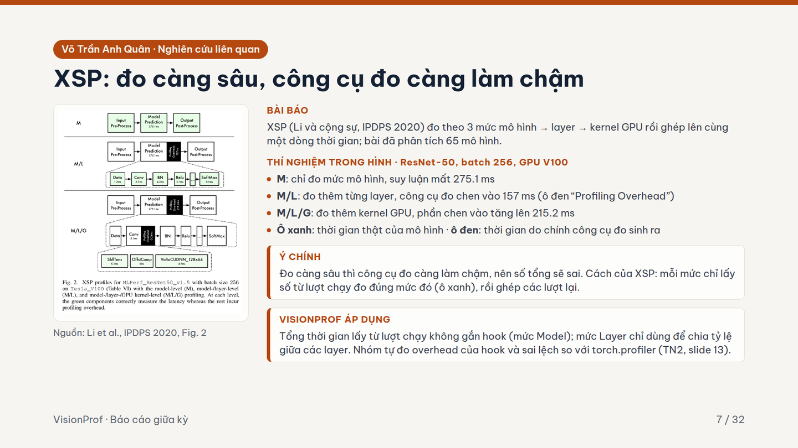

**Ý chính:** đo càng sâu thì chính công cụ đo càng làm chậm, nên không lấy tổng thời gian từ lượt đo chi tiết.

**Hiểu:**
- **Hình của bài:** ResNet-50, batch 256, GPU V100.
  - Chỉ đo mô hình (M): **275.1 ms**.
  - Đo thêm từng layer (M/L): công cụ chen vào **157 ms**.
  - Đo thêm kernel (M/L/G): chen vào **215.2 ms**.
  - Ô **xanh** là thời gian thật, ô **đen** là thời gian do công cụ đo sinh ra.
- **Cách giải của XSP:** mỗi mức lấy số ở lượt chạy của đúng mức đó, rồi ghép lại.
- **Nhóm làm giống vậy:**
  - Trí đo tổng thời gian ở lượt **không gắn hook**.
  - Mức Layer chỉ dùng để **chia tỷ lệ** giữa các layer.

**Nói:**
> Bài thứ ba là XSP, năm 2020, phân tích 65 mô hình theo 3 mức: mô hình, layer, kernel GPU. Trong hình, ResNet-50 suy luận mất 275 mili giây. Đo thêm từng layer thì công cụ chen vào 157 mili giây, đo thêm kernel thì lên 215 mili giây. Ô đen chính là thời gian do công cụ đo sinh ra. Vì vậy mỗi mức chỉ lấy số ở lượt đo của đúng mức đó. Nhóm em cũng vậy: tổng thời gian lấy ở lượt không gắn hook, mức Layer chỉ dùng để chia tỷ lệ. Overhead của nhóm em đo ở slide 13.

## Slide 8 · So sánh và khoảng trống · ~60 giây

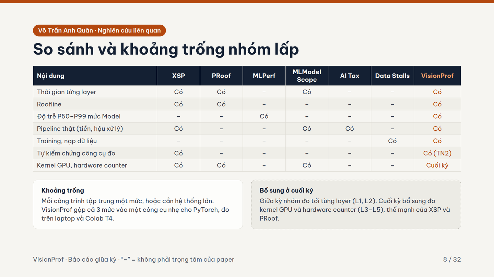

**Ý chính:** mỗi công trình mạnh ở một mức; VisionProf gộp 3 mức vào một công cụ nhẹ; phần đo tới kernel sẽ bổ sung ở cuối kỳ.

**Hiểu:**
- Dấu **"–"** nghĩa là không phải trọng tâm của bài, **không** có nghĩa là bài không nhắc tới.
- **Mỗi công trình mạnh ở:**
  - **XSP, PRoof:** đo layer, kernel GPU và Roofline.
  - **MLPerf:** chuẩn cách đo độ trễ theo phân vị P50–P99.
  - **AI Tax:** phần AI chỉ chiếm dưới 60% độ trễ của ứng dụng thật.
  - **Data Stalls:** training hay phải chờ nạp dữ liệu.
- **Bổ sung ở cuối kỳ:** giữa kỳ đo tới từng layer (L1, L2); cuối kỳ thêm kernel GPU và hardware counter (L3–L5). Ô cuối bảng ghi "Cuối kỳ".

**Nói:**
> Bảng này so 6 công trình với VisionProf. XSP và PRoof mạnh ở layer và kernel; MLPerf chuẩn hoá cách đo độ trễ; AI Tax và Data Stalls chỉ ra các bước ngoài mô hình như tiền xử lý, nạp dữ liệu chiếm nhiều thời gian. Khoảng trống: mỗi công trình tập trung một mức hoặc cần hệ thống lớn. VisionProf gộp cả 3 mức vào một công cụ nhẹ cho PyTorch, chạy trên laptop và Colab T4, có thí nghiệm tự kiểm chứng. Giữa kỳ nhóm đo tới từng layer; phần đo sâu tới kernel GPU, thế mạnh của XSP và PRoof, nhóm sẽ bổ sung ở cuối kỳ. Bây giờ em bắt đầu từ mức sâu nhất, mức Layer.

## Slide 9 · Đo thời gian trên GPU · ~75 giây

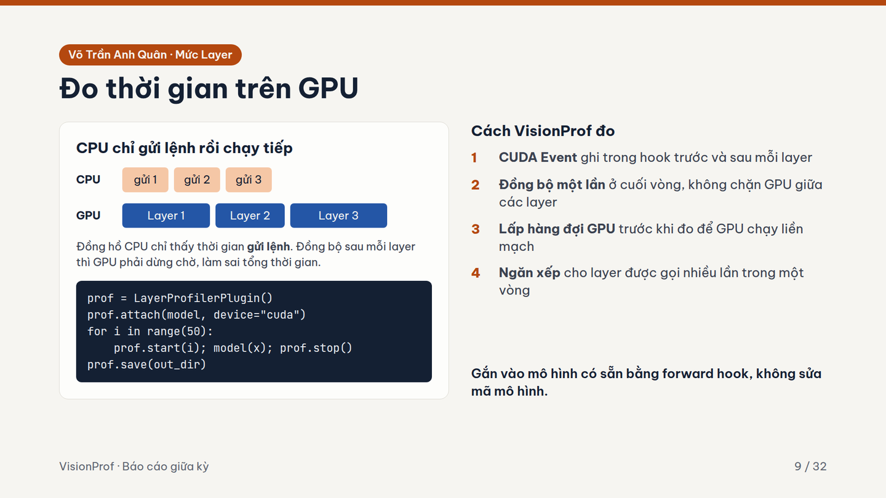

**Ý chính:** CPU không chờ GPU nên đo bằng đồng hồ CPU là sai; nhóm dùng 4 kỹ thuật để đo đúng.

**Hiểu:**
- CPU chỉ **gửi lệnh** vào hàng đợi rồi làm tiếp, giống gửi đơn hàng xong chưa có nghĩa là hàng đã giao. Đồng hồ CPU chỉ đo được lúc gửi.
- Đồng bộ (bắt CPU chờ GPU) sau mỗi layer thì đo đúng từng layer, nhưng GPU bị ngắt quãng nên tổng thời gian sai.
- **4 kỹ thuật:**
  1. **CUDA Event:** mốc thời gian do chính GPU ghi khi chạy tới.
  2. **Đồng bộ 1 lần** cuối vòng rồi đọc hết các mốc.
  3. **Lấp hàng đợi** để GPU chạy liền mạch.
  4. **Ngăn xếp** để ghép đúng cặp vào, ra khi một layer bị gọi nhiều lần.

**Nói:**
> Thách thức đầu tiên là đo trên GPU. CPU chỉ gửi lệnh rồi chạy tiếp, GPU chạy sau. Dùng đồng hồ CPU thì chỉ đo được thời gian gửi lệnh, gần như bằng 0. Đồng bộ sau mỗi layer thì GPU phải dừng chờ, tổng thời gian bị đội lên. Nhóm em làm 4 việc: ghi CUDA Event trong hook trước và sau mỗi layer, chỉ đồng bộ một lần cuối vòng, lấp hàng đợi để GPU chạy liền mạch, và dùng ngăn xếp cho layer gọi nhiều lần. Người dùng chỉ cần khoảng 5 dòng code, không sửa mô hình.

## Slide 10 · CH1: thời gian dồn vào loại layer nào · ~75 giây

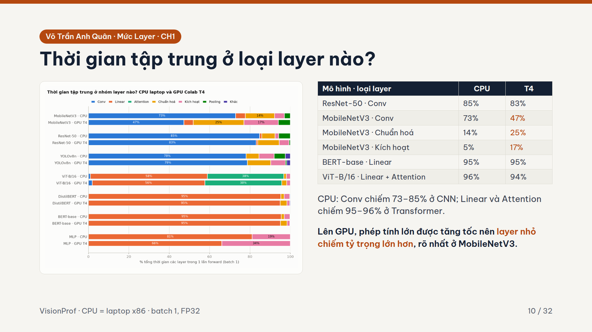

**Ý chính:** trên CPU thời gian dồn vào phép tính lớn; lên GPU thì layer nhỏ chiếm phần lớn hơn, rõ nhất ở MobileNetV3.

**Hiểu:**
- **Trên CPU:** Conv chiếm **73–85%** ở CNN; Linear + Attention chiếm **95–96%** ở Transformer.
- **MobileNetV3 từ CPU lên T4:**
  - Conv **73 → 47%**;
  - chuẩn hoá **14 → 25%**;
  - kích hoạt **5 → 17%**.
- **Vì sao:**
  - GPU làm phép tính lớn nhanh hơn rất nhiều.
  - Layer nhỏ như BatchNorm, ReLU chủ yếu tốn **chi phí khởi chạy** nên gần như không nhanh lên.
  - Phần lớn co lại, phần nhỏ giữ nguyên, nên tỷ trọng của phần nhỏ tăng.
- ResNet-50 và Transformer có layer lớn áp đảo nên tỷ trọng gần như không đổi.

**Nói:**
> Câu hỏi CH1: thời gian dồn vào loại layer nào. Mỗi mô hình có 2 thanh, CPU laptop và GPU T4. Trên CPU, CNN dồn 73 đến 85% vào Conv, Transformer dồn 95 đến 96% vào Linear và Attention. Điều thú vị là trên GPU: với MobileNetV3, Conv giảm từ 73 xuống 47%, còn chuẩn hoá tăng lên 25%, kích hoạt lên 17%. Lý do: GPU tăng tốc mạnh phép tính lớn, còn layer nhỏ chủ yếu là chi phí khởi chạy nên gần như không nhanh hơn. Vì vậy trên GPU, layer nhỏ chiếm tỷ trọng lớn hơn.

## Slide 11 · CH1: GPU nhanh hơn CPU bao nhiêu lần · ~40 giây

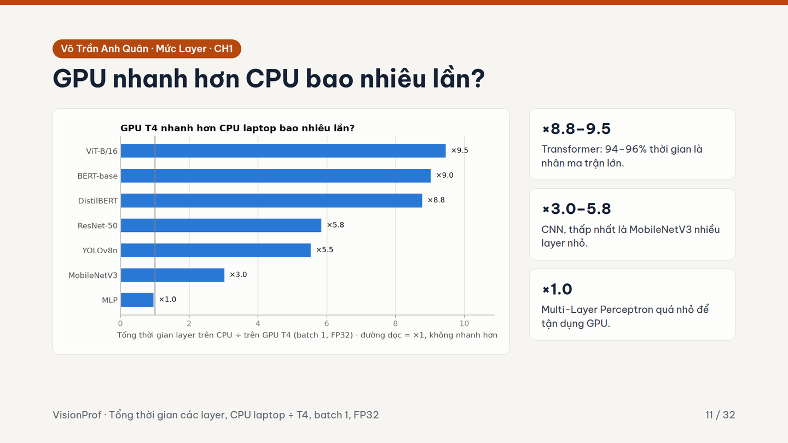

**Ý chính:** mô hình càng nhiều phép nhân ma trận lớn thì GPU càng giúp nhiều.

**Hiểu:**
- **Cách tính:** tổng thời gian các layer trên CPU ÷ trên T4.
- **Kết quả theo nhóm mô hình:**
  - **Transformer ×8.8–9.5:** ViT 9.5, BERT 9.0, DistilBERT 8.8.
  - **CNN ×3.0–5.8:** ResNet-50 5.8, YOLOv8n 5.5, MobileNetV3 3.0.
  - **MLP ×1.0.**
- **Nối với slide 10:** layer nhỏ không nhanh lên trên GPU, nên mô hình nhiều layer nhỏ (MobileNetV3) tăng tốc ít. MLP quá nhỏ để GPU có lợi.

**Nói:**
> Lấy tổng thời gian trên CPU chia cho trên T4. Transformer tăng tốc mạnh nhất, 8.8 đến 9.5 lần, vì gần hết thời gian là nhân ma trận lớn, việc GPU làm giỏi nhất. CNN tăng 3 đến 5.8 lần, thấp nhất là MobileNetV3 vì nhiều layer nhỏ. MLP gần như không nhanh hơn vì mô hình quá nhỏ.

## Slide 12 · CH1: vì sao layer lớn chưa nhanh hơn nữa · ~35 giây

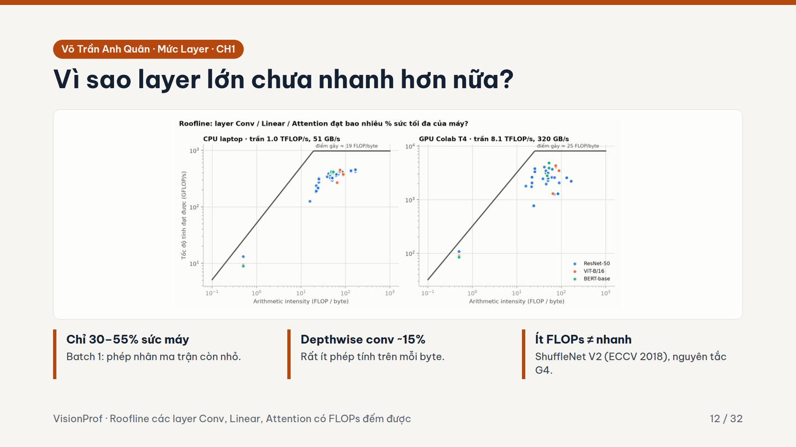

**Ý chính:** đặt layer thật lên Roofline của slide 6 thì layer lớn chỉ dùng được 30–55% sức máy.

**Hiểu:**
- Mỗi chấm trên hình là một layer. Chấm càng xa đường mái thì càng phí sức máy.
- **30–55%:** ở batch 1 ma trận còn nhỏ, GPU chưa đủ việc để chạy hết các nhân.
- **Depthwise conv ~15%:** đây là loại Conv mà mỗi kênh có bộ lọc riêng, nên rất ít phép tính trên mỗi byte và nghẽn bộ nhớ.
- **Nguyên tắc G4 của ShuffleNet V2 (2018):** phép toán từng phần tử như ReLU, phép cộng có ít FLOPs nhưng vẫn tốn thời gian vì đọc ghi bộ nhớ. Nên **ít FLOPs không có nghĩa là nhanh**.

**Nói:**
> Vậy vì sao layer lớn chưa nhanh hơn nữa? Đây là Roofline của các layer Conv, Linear, Attention, trái là CPU, phải là T4. Phần lớn layer chỉ đạt 30 đến 55% sức máy, vì ở batch 1 phép nhân ma trận còn nhỏ. Depthwise conv của MobileNetV3 chỉ khoảng 15% vì có rất ít phép tính trên mỗi byte. Điều này khớp với nguyên tắc G4 của ShuffleNet V2: ít FLOPs chưa chắc đã nhanh.

## Slide 13 · CH2: công cụ đo có đúng không · ~75 giây

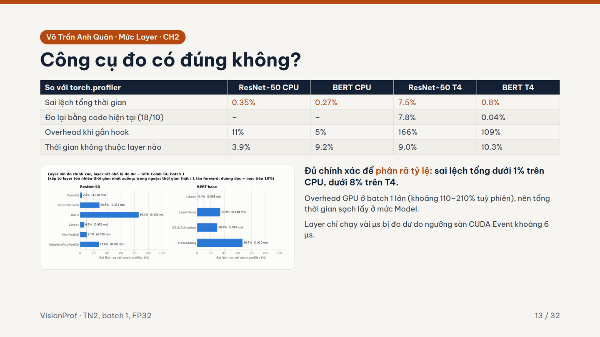

**Ý chính:** so với torch.profiler, công cụ đủ chính xác để chia tỷ lệ; nhóm nói rõ 3 giới hạn.

**Hiểu:**

| | ResNet-50 CPU | BERT CPU | ResNet-50 T4 | BERT T4 |
| :-- | :-: | :-: | :-: | :-: |
| Sai lệch tổng thời gian | 0.35% | 0.27% | 7.5% | 0.8% |
| Đo lại 18/10 | – | – | 7.8% | 0.04% |
| Overhead khi gắn hook | 11% | 5% | 166% | 109% |
| Không thuộc layer nào | 3.9% | 9.2% | 9.0% | 10.3% |

- **Sai lệch** dưới 1% trên CPU, dưới 8% trên T4: đủ để chia tỷ lệ.
- **Overhead trên T4 lớn (110–210% tuỳ phiên):**
  - Mỗi layer trên GPU chỉ chạy vài chục µs, nên chi phí gọi hook tính ra phần trăm thành lớn.
  - Vì thế tổng thời gian lấy ở mức Model, đúng bài học XSP.
- **4–10% không thuộc layer nào:** phép cộng shortcut, `torch.cat` là hàm, không phải layer, nên không có hook.
- **Sàn ~6 µs:** việc ngắn hơn mức này (ReLU, BatchNorm ở batch 1) bị đo dư.

**Nói:**
> Câu hỏi CH2: công cụ đo có đúng không. Nhóm so với torch.profiler, công cụ chính thức của PyTorch. Sai lệch tổng thời gian trên CPU dưới 1%, trên T4 dưới 8%, đo lại hôm 18/10 vẫn vậy. Có hai điểm em nói thẳng. Một, gắn hook trên GPU làm mô hình chậm hơn 110 đến 210%, nên nhóm chỉ dùng mức Layer để chia tỷ lệ, còn tổng thời gian lấy ở mức Model, đúng bài học XSP. Hai, khoảng 4 đến 10% thời gian là phép cộng shortcut hay torch.cat, không có hook, nhóm báo con số này chứ không bỏ qua. Ngoài ra layer chỉ chạy vài micro giây bị đo dư do ngưỡng sàn khoảng 6 micro giây. Tóm lại, mức Layer đủ chính xác để phân rã và biết rõ giới hạn của mình.

## Slide 14 · Dashboard · ~15 giây

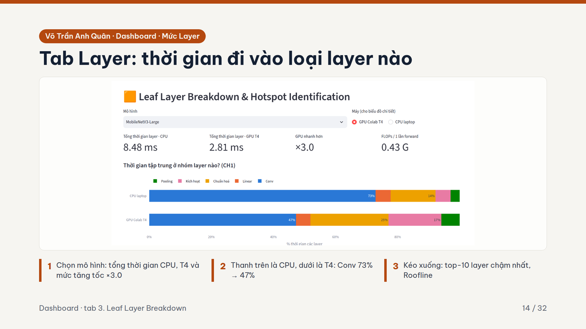

**Ý chính:** kết quả CH1 xem trực tiếp trên dashboard.

**Hiểu:**
- **Ví dụ MobileNetV3:** CPU **8.48 ms**, T4 **2.81 ms**, nhanh hơn **×3.0**. Conv **73 → 47%**.
- **Nếu thầy muốn xem thật:**
  - Chạy `streamlit run src/dashboard/app.py`, mở tab **"3. Leaf Layer Breakdown"**.
  - Lần đầu chạy, nếu Streamlit hỏi email thì bấm Enter để bỏ qua.

**Nói:**
> Các kết quả này xem trực tiếp trên dashboard của nhóm. Chọn MobileNetV3: CPU 8.48 mili giây, T4 2.81, GPU nhanh hơn 3 lần. Biểu đồ bên dưới đúng là kết quả CH1: Conv giảm từ 73 xuống 47%. Kéo xuống có top-10 layer chậm nhất và Roofline. Đo tổng thời gian sạch của cả mô hình là phần của bạn Trí.

---

## Câu hỏi hay gặp

- **Overhead 110–210% sao vẫn tin số đo?**
  - Overhead làm mô hình chạy chậm hơn, nhưng sai lệch so với torch.profiler vẫn dưới 8%.
  - Mức Layer chỉ dùng chia tỷ lệ; tổng thời gian lấy ở lượt không gắn hook.
- **Sao không dùng luôn torch.profiler?**
  - torch.profiler là thước chuẩn để kiểm chứng.
  - Nhóm cần thêm FLOPs, Roofline, và gắn được vào training, pipeline, nên viết bộ đo nhẹ riêng.
- **Đồng bộ 1 lần thì sao biết từng layer?** Mốc CUDA Event do GPU ghi khi chạy tới. Đồng bộ cuối vòng chỉ để chờ xong rồi đọc các mốc.
- **Đỉnh Roofline lấy đâu ra?**
  - T4 theo thông số NVIDIA: 8.1 TFLOPS, 320 GB/s.
  - CPU ước lượng theo số nhân × xung nhịp, băng thông 51.2 GB/s.
- **Sao đo batch 1?** Giống lúc dùng thật (từng ảnh một) và là trường hợp khó nhất cho GPU. Batch lớn là phần CH4 của Trí.
- **CPU là máy nào?** Laptop x86 của em. Không so với CPU ở TN3, TN4 vì đó là MacBook chip Apple.
