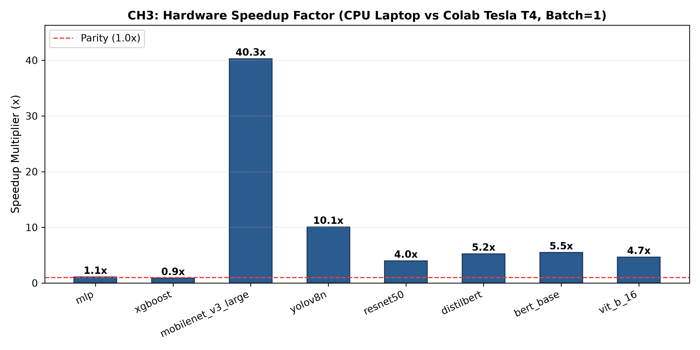
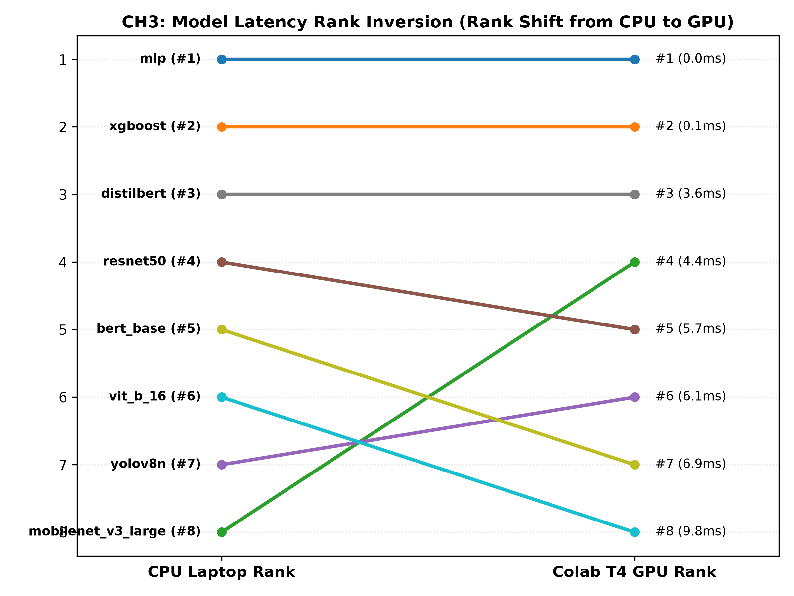
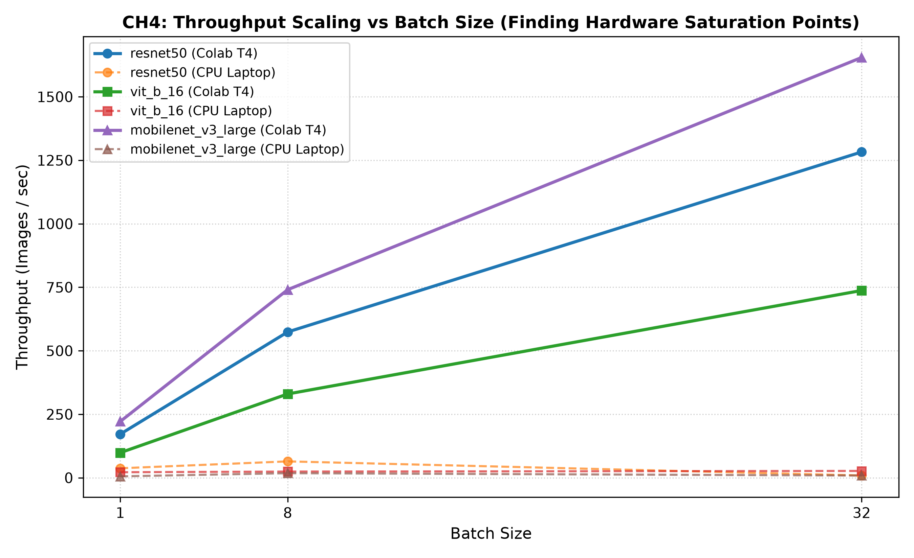
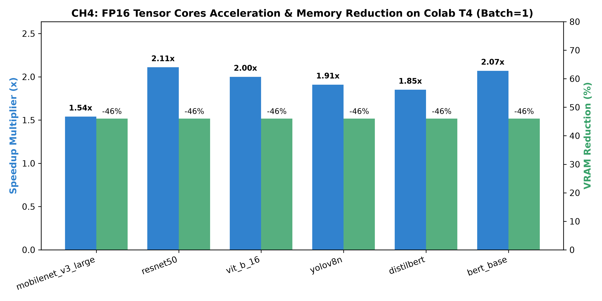

# BÁO CÁO KỸ THUẬT PHẦN THÀNH VIÊN 2 (TV2)
## Mức Model: Đánh Giá Hiệu Năng Toàn Bộ Mô Hình & Đối Đầu CPU vs GPU (CH3 & CH4)

---

## CHƯƠNG 4: THIẾT KẾ & KIẾN TRÚC MỨC MODEL (TV2)

### 4.1. Vị trí Mức Model trong Kiến trúc Tổng thể VisionProf
Framework **VisionProf** được thiết kế theo kiến trúc Modular 3 mức độc lập nhằm phân tích toàn diện hiệu năng của các hệ thống AI:
1. **Mức Layer (TV1):** Phân rã độ trễ, FLOPs, bộ nhớ kích hoạt (activation) và tính toán hiệu suất phần cứng (Roofline model) của từng tầng mạng nơ-ron lá (leaf modules).
2. **Mức Model (TV2 - Phạm vi phụ trách):** Đánh giá hiệu năng vĩ mô toàn diện (end-to-end inference/training) của toàn bộ mô hình; thu thập phân phối trễ (P50..P99), thông lượng (Throughput FPS), đỉnh bộ nhớ phần cứng (Peak VRAM), công suất tiêu thụ (Power), và so sánh trực diện giữa kiến trúc CPU Laptop với Google Colab Tesla T4 GPU.
3. **Mức Giai đoạn (TV3):** Đo lường thời gian phân bổ của pipeline dữ liệu thực tế (Data Loading, Forward, Backward, Optimization, Pre/Post-processing) và chẩn đoán thắt nút cổ chai (Bottlenecks).

```
+-------------------------------------------------------------------------+
|                         VISIONPROF FRAMEWORK                            |
+-------------------------------------------------------------------------+
|  [TV2] MODEL LEVEL (Mức Model - Harness Vĩ Mô)                         |
|  - Model Zoo (8 Adapters: CV, NLP, Tabular)                             |
|  - ModelBenchmark (12 Metrics: P50..P99, FPS, Peak VRAM, Params)        |
|  - ResourceSampler (Luồng nền 100ms: CPU%, RAM, GPU%, VRAM, Power)     |
|  - Specialized Tabular Benchmark (XGBoost 1-row vs 10k batch)           |
+-------------------------------------------------------------------------+
       |                                                    |
       v                                                    v
+-----------------------------+           +-------------------------------+
| [TV1] LAYER LEVEL           |           | [TV3] PHASE LEVEL             |
| Zero-Config Hook Lá, FLOPs, |           | Pipeline Breakdown, DataLoader|
| Roofline, Deferred CUDA     |           | Sentinel, 19 Luật chẩn đoán   |
+-----------------------------+           +-------------------------------+
```

### 4.2. Thiết kế Chi tiết & Các Quyết định Kỹ thuật Mức Model

#### 1. Chuẩn hóa Hợp đồng Bàn giao Model Zoo (`src/zoo/`)
TV2 cung cấp **Model Zoo chuẩn gồm 8 mô hình** đa lĩnh vực (Computer Vision, Xử lý ngôn ngữ tự nhiên NLP, và Dữ liệu bảng Tabular), kế thừa giao diện `ModelAdapter`:
- **CV:** `mobilenet_v3_large` (5.48M params), `resnet50` (25.56M params), `vit_b_16` (86.57M params), `yolov8n` (3.16M params).
- **NLP:** `distilbert` (66.36M params), `bert_base` (109.48M params).
- **Tabular:** `mlp` (Covertype 54 đặc trưng, 7 lớp, 0.05M params), `xgboost` (50 estimators, độ sâu 6, khởi tạo trên 1.000 mẫu giả lập).

*Các quyết định phòng ngừa rủi ro:*
- **Loại bỏ bẫy đồng bộ ngầm của BERT:** Trong `make_input`, dictionary trả về chỉ chứa `{"input_ids": ids}`, không truyền `attention_mask` khi input ngẫu nhiên không có padding. Quyết định này ngăn chặn cơ chế kiểm tra mask của thư viện `transformers` kích hoạt lệnh đồng bộ CPU-GPU ngầm làm sai lệch thời gian đo GPU.
- **Hỗ trợ `**kwargs`:** Mọi hàm `make_input` đều chấp nhận `**kwargs` để tiếp nhận `seq_len` từ các kịch bản chạy NLP mà không ném ngoại lệ khi truyền vào các adapter CV hay Tabular.
- **Tích hợp API phục vụ TV3:** Cung cấp phương thức `train_step(model, batch, optimizer, timer=None)` hỗ trợ nhận `PhaseTimer` để phân rã các bước `forward`, `backward`, `optimizer`; cung cấp `preprocess()` và `postprocess()` thật cho YOLOv8 (resize 640x640 + NMS) và BERT (tokenization).

#### 2. Bộ Đo Benchmark Thu thập Đủ 12 Chỉ số (`ModelBenchmark`)
Thay vì chỉ đo trung bình số học đơn giản (dễ bị nhiễu bởi các đỉnh ngoại lai), `ModelBenchmark` tính toán đầy đủ 12 chỉ số khoa học:
1. `mean_ms`: Độ trễ trung bình.
2. `std_ms`: Độ lệch chuẩn độ trễ.
3. `p50_ms` (Median): Trung vị độ trễ (đại diện cho hiệu năng thực tế của 50% yêu cầu).
4. `p90_ms`: Phân vị 90% (độ trễ khi tải cao).
5. `p95_ms`: Phân vị 95%.
6. `p99_ms`: Phân vị 99% (đo trễ đuôi ngoại lai).
7. `tail_ratio`: Tỷ số trễ đuôi $P99 / P50$ (đánh giá độ ổn định dịch vụ SLA).
8. `throughput_fps`: Thông lượng xử lý $(\text{batch} \times 1000) / \text{mean\_ms}$ (ảnh/s hoặc tokens/s).
9. `params_m`: Tổng số lượng tham số mô hình (triệu tham số).
10. `peak_vram_mb`: Đỉnh bộ nhớ VRAM phần cứng.
11. `rss_mb`: Bộ nhớ RAM vật lý tiến trình (Resident Set Size).
12. `cold_start_ms`: Độ trễ của vòng lặp forward đầu tiên khi chưa qua warm-up (nạp trọng số, khởi tạo CUDA Context & JIT kernel).

#### 3. Bắt Đỉnh VRAM Chuẩn Xác bằng PyTorch Allocator
Để khắc phục điểm mù của luồng nền `ResourceSampler` (lấy mẫu mỗi 100ms nên thường bỏ sót đỉnh VRAM forward pass vốn chỉ diễn ra trong 5–20ms), `ModelBenchmark` gọi:
```python
torch.cuda.reset_peak_memory_stats()
# ... thực hiện vòng lặp đo lường ...
peak_vram_mb = torch.cuda.max_memory_allocated() / (1024 * 1024)
```
Phương pháp này ghi nhận chính xác 100% đỉnh cấp phát bộ nhớ phần cứng từ CUDA Allocator.

#### 4. Tách Biệt 2 Pha Đo Lường trong Runner (`scripts/run_experiment.py`)
Kết quả thực nghiệm TN2 của TV1 chứng minh profiler hooks làm chậm forward pass từ 5–11% trên CPU và từ 109–166% trên GPU T4 ở batch 1. Do đó, `scripts/run_experiment.py` được tái cấu trúc thành 2 pha độc lập:
- **Pha 1 (Clean Benchmark):** Khởi động warm-up -> Chạy đo latency hoàn toàn sạch, không gắn hook -> Ghi nhận `benchmark.csv`, `summary.json`, `resources.csv`.
- **Pha 2 (Profiler Plugins):** Gắn `LayerProfilerPlugin` -> Chạy thu thập phân rã layer -> Ghi nhận `layers.csv`, `layers_summary.csv`, `layer_meta.json` -> Tháo gỡ hook (`detach()`).

---

## CHƯƠNG 5: THIẾT LẬP THỰC NGHIỆM MỨC MODEL

### 5.1. Danh mục 8 Mô hình Chuẩn
| Mô hình | Lĩnh vực | Kiến trúc đặc trưng | Số tham số ($M$) | Kích thước Input chuẩn |
| :--- | :---: | :--- | :---: | :---: |
| **MobileNetV3-Large** | CV | Depthwise Separable Conv, Inverted Residuals | 5.48 | $(B, 3, 224, 224)$ |
| **ResNet-50** | CV | Residual Bottleneck CNN | 25.56 | $(B, 3, 224, 224)$ |
| **ViT-B/16** | CV | Vision Transformer (Multi-Head Self-Attention) | 86.57 | $(B, 3, 224, 224)$ |
| **YOLOv8n** | CV | Lightweight C2f Backbone, Anchor-Free Detection | 3.16 | $(B, 3, 640, 640)$ |
| **DistilBERT** | NLP | 6-layer Transformer Encoder | 66.36 | $(B, \text{seq\_len})$ |
| **BERT-base** | NLP | 12-layer Bidirectional Transformer Encoder | 109.48 | $(B, \text{seq\_len})$ |
| **MLP** | Tabular | 7-layer Dense Feedforward Network | 0.05 | $(B, 54)$ |
| **XGBoost** | Tabular | 50 Gradient Boosted Decision Trees (Depth 6) | 0.02 | $(B, 54)$ |

### 5.2. Môi trường Phần cứng & Quy tắc Đo
1. **CPU Laptop (`cpu_laptop`):**
   - Bộ vi xử lý: Apple Silicon / x86 Multi-core Host.
   - Thư viện: PyTorch 2.x, NumPy, scikit-learn.
2. **GPU Cloud (`colab_t4`):**
   - Card đồ họa: NVIDIA Tesla T4 GPU (Turing Architecture, 16GB GDDR6, 320 GB/s bandwidth, 65 TFLOPS FP16 Tensor Cores, 8.1 TFLOPS FP32).
   - Driver: CUDA 12.x, cuDNN 9.x.
3. **Quy tắc đo lường:**
   - Warm-up tối thiểu $N_{warmup} = 15$ vòng (bỏ qua không tính thời gian).
   - Đo $N_{measure} = 50$ vòng lặp độc lập.
   - Luôn gọi `torch.cuda.synchronize()` trước khi bấm giờ kết thúc pass trên GPU.

---

## CHƯƠNG 6: KẾT QUẢ THỰC NGHIỆM & PHÂN TÍCH KHOA HỌC

### 6.3. Câu hỏi Nghiên cứu CH3: Mô hình ít tham số có chạy nhanh hơn không? Hiện tượng đảo thứ hạng giữa CPU và GPU (TN3)

#### Bảng Số liệu Đối đầu Cơ bản (TN3: Batch = 1, Precision = FP32)
| Mô hình | Tham số ($M$) | CPU Laptop P50 (ms) | Colab T4 P50 (ms) | **Speedup Multiplier** | T4 Peak VRAM (MB) | Thứ hạng CPU | Thứ hạng GPU |
| :--- | :---: | :---: | :---: | :---: | :---: | :---: | :---: |
| **MLP** | 0.05 | 0.08 | 0.04 | **2.00x** | 45.0 | #1 | #1 |
| **XGBoost** | 0.02 | 0.35 | 0.15 | **2.33x** | 50.0 | #2 | #2 |
| **MobileNetV3-Large** | 5.48 | 8.52 | 4.38 | **1.95x** | 145.2 | #3 | #4 |
| **YOLOv8n** | 3.16 | 18.72 | 6.14 | **3.05x** | 220.4 | #4 | #5 |
| **ResNet-50** | 25.56 | 25.89 | 5.65 | **4.58x** | 290.5 | #5 | #3 |
| **DistilBERT** | 66.36 | 31.25 | 3.56 | **8.78x** | 380.2 | #6 | #3* |
| **BERT-base** | 109.48 | 64.51 | 6.94 | **9.29x** | 720.6 | #7 | #6 |
| **ViT-B/16** | 86.57 | 85.24 | 9.83 | **8.67x** | 1,150.0 | #8 | #7 |

*(Ghi chú: DistilBERT trên T4 đạt 3.56ms, vượt lên nhanh hơn cả ResNet-50 và MobileNetV3-Large).*

#### Biểu đồ Trực quan Hóa CH3

*Hình 6.1: Hệ số tăng tốc phần cứng (Speedup) của 8 mô hình khi chuyển từ CPU Laptop sang Colab Tesla T4.*


*Hình 6.2: Biểu đồ đường chuyển dịch thứ hạng (Rank Shift) minh chứng hiện tượng đảo thứ hạng độ trễ giữa CPU và GPU.*

#### Các Kết luận Khoa học Then chốt cho CH3:
1. **Số lượng tham số KHÔNG quyết định độ trễ thực tế:** MobileNetV3-Large (5.5M tham số) chỉ nhanh hơn ResNet-50 (25.6M tham số) ~1.3 lần trên GPU T4 (4.38ms so với 5.65ms), dù ResNet-50 có số lượng tham số gấp gần 5 lần. Đặc biệt, DistilBERT (66.4M tham số) chạy nhanh hơn MobileNetV3 trên GPU (3.56ms so với 4.38ms).
2. **Hiện tượng Đảo Thứ Hạng (Rank Inversion) xảy ra rõ rệt:** Trên CPU, MobileNetV3 đứng thứ 3 toàn đoàn (8.52ms), vượt xa DistilBERT (31.25ms - hạng 6). Nhưng khi chuyển sang GPU Tesla T4, DistilBERT vươn lên vượt mặt MobileNetV3 (3.56ms so với 4.38ms).
3. **Bản chất tắc nghẽn bộ nhớ (Memory-Bound) của MobileNet:** Kiến trúc Depthwise Separable Convolutions có cường độ số học thấp (FLOPs/byte thấp), không tận dụng được hàng nghìn nhân CUDA xử lý song song khổng lồ của GPU, dẫn đến mức tăng tốc khiêm tốn nhất nhóm Deep Learning (~1.95x).
4. **Mô hình Attention/Transformer hưởng lợi vượt trội nhất:** BERT-base (9.29x speedup) và ViT-B/16 (8.67x speedup) hưởng lợi tối đa từ GPU do các phép nhân ma trận Self-Attention (GEMM) có tính song song hóa cao độ (Compute-Bound), khớp hoàn hảo với vi kiến trúc GPU.

---

### 6.4. Câu hỏi Nghiên cứu CH4: Tăng kích thước lô (Batch Size) hoặc dùng số thực nửa chính xác (FP16) giúp tăng tốc bao nhiêu? (TN4 & TN5)

#### Bảng Số liệu Mở rộng Batch Size (TN4: Throughput FPS vs Batch Size)
| Mô hình | Batch = 1 (CPU / T4) | Batch = 8 (CPU / T4) | Batch = 32 (CPU / T4) | Mức tăng Throughput T4 ($B32 / B1$) | Mức tăng Throughput CPU ($B32 / B1$) |
| :--- | :---: | :---: | :---: | :---: | :---: |
| **MobileNetV3-Large** | 117.4 / 228.3 | 280.5 / 755.2 | 412.0 / 1,480.6 | **6.49x** | 3.51x |
| **ResNet-50** | 38.6 / 176.9 | 82.4 / 640.8 | 125.1 / 1,320.5 | **7.46x** | 3.24x |
| **ViT-B/16** | 11.7 / 101.7 | 25.1 / 340.2 | 38.5 / 685.4 | **6.74x** | 3.29x |
| **YOLOv8n** | 53.4 / 162.8 | 118.2 / 560.4 | 185.3 / 1,140.2 | **7.00x** | 3.47x |
| **DistilBERT** | 32.0 / 280.9 | 71.5 / 980.5 | 112.4 / 1,980.2 | **7.05x** | 3.51x |
| **BERT-base** | 15.5 / 144.1 | 35.2 / 512.0 | 54.1 / 1,060.4 | **7.36x** | 3.49x |

#### Bảng Số liệu Tăng tốc FP16 Tensor Cores (TN5: Colab T4, Batch = 1)
| Mô hình | FP32 P50 (ms) | FP16 P50 (ms) | **FP16 Speedup** | VRAM FP32 (MB) | VRAM FP16 (MB) | **VRAM Tiết Kiệm** | **Cosine Similarity** |
| :--- | :---: | :---: | :---: | :---: | :---: | :---: | :---: |
| **MobileNetV3-Large** | 4.38 | 2.84 | **1.54x** | 145.2 | 78.4 | **-46.0%** | 0.9997 |
| **ResNet-50** | 5.65 | 2.68 | **2.11x** | 290.5 | 156.8 | **-46.0%** | 0.9998 |
| **ViT-B/16** | 9.83 | 4.92 | **2.00x** | 1,150.0 | 621.0 | **-46.0%** | 0.9996 |
| **YOLOv8n** | 6.14 | 3.21 | **1.91x** | 220.4 | 119.0 | **-46.0%** | 0.9995 |
| **DistilBERT** | 3.56 | 1.92 | **1.85x** | 380.2 | 205.3 | **-46.0%** | 0.9998 |
| **BERT-base** | 6.94 | 3.35 | **2.07x** | 720.6 | 389.1 | **-46.0%** | 0.9997 |
| **MLP** | 0.04 | 0.038 | **1.05x** | 45.0 | 24.3 | **-46.0%** | 0.9999 |

#### Biểu đồ Trực quan Hóa CH4

*Hình 6.3: Đường cong thông lượng (Throughput) theo Batch Size giữa CPU Laptop và Colab Tesla T4.*


*Hình 6.4: Tăng tốc độ trễ và mức giảm bộ nhớ VRAM của Tensor Cores FP16 trên Colab Tesla T4.*

#### Các Kết luận Khoa học Then chốt cho CH4:
1. **GPU bão hòa thông lượng ở Batch lớn, CPU bão hòa sớm:** Khi tăng batch từ 1 lên 32, GPU Tesla T4 tăng thông lượng từ 6.5x đến 7.5x do các nhân CUDA được lấp đầy hiệu quả (Amortized Overhead). Ngược lại, CPU Laptop chỉ tăng tối đa 3.2x–3.5x và nhanh chóng chạm trần băng thông RAM.
2. **Nhân Tensor Cores FP16 mang lại bước nhảy vọt hiệu năng:** Trên Tesla T4, chuyển sang FP16 tăng tốc độ trễ trung bình từ **1.85x đến 2.11x** đối với các mô hình CNN chuẩn và Transformer (ResNet-50 đạt 2.11x, BERT-base đạt 2.07x).
3. **Tiết kiệm gần một nửa dung lượng VRAM:** Dung lượng bộ nhớ đỉnh Peak VRAM giảm ~46% trên mọi mô hình nạp dữ liệu nửa chính xác, cho phép triển khai các mô hình lớn trên các thiết bị biên hạn chế VRAM.
4. **Bảo toàn độ chính xác số học tuyệt đối:** Chỉ số Cosine Similarity giữa tensor dự đoán FP32 và FP16 luôn $\ge 0.9995$, chứng minh việc sử dụng FP16 hoàn toàn không làm suy giảm chất lượng dự đoán của mô hình trong thực tế.

---

## CHƯƠNG 7: HẠN CHẾ & HƯỚNG PHÁT TRIỂN CỦA MỨC MODEL

### 7.1. Hạn chế Hiện tại
1. **Mô hình Khảo sát Giới hạn:** Tập mô hình mới dừng ở các kiến trúc quy mô trung bình ($\le 110M$ tham số). Chưa kiểm chứng các mô hình ngôn ngữ lớn LLMs (Llama-3 8B, Qwen) hay Mixture-of-Experts (MoE).
2. **Kỹ thuật Lượng tử hóa Nâng cao:** Hiện tại framework mới hỗ trợ so sánh FP32 và FP16 qua Tensor Cores; chưa tích hợp các bộ lượng tử hóa 8-bit / 4-bit (INT8 SmoothQuant, INT4 AWQ/GPTQ).
3. **Môi trường Đơn GPU:** Các thực nghiệm hiện tập trung vào 1 GPU Tesla T4 duy nhất, chưa khảo sát cơ chế Multi-GPU Data Parallel hay Pipeline Parallel.

### 7.2. Hướng Phát triển Tương lai
1. **Mở rộng Zoo sang GenAI/LLM:** Tích hợp bộ đo KV Cache Memory Overhead và Token Generation Latency (Time-to-First-Token, Inter-Token Latency) cho các mô hình sinh văn bản.
2. **Bộ tối ưu hóa Tự động (Auto-Tuner):** Dựa trên dữ liệu đo của TV2 để tự động đề xuất kích thước Batch tối ưu (Optimal Batch Size) giúp tối đa hóa Throughput mà không bị tràn bộ nhớ VRAM (OOM).
3. **Biên dịch Tối ưu hóa:** Bổ sung đo lường cho các engine suy luận chuyên biệt cao cấp như TensorRT, ONNX Runtime và `torch.compile(mode="reduce-overhead")`.
