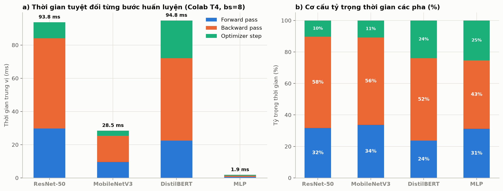
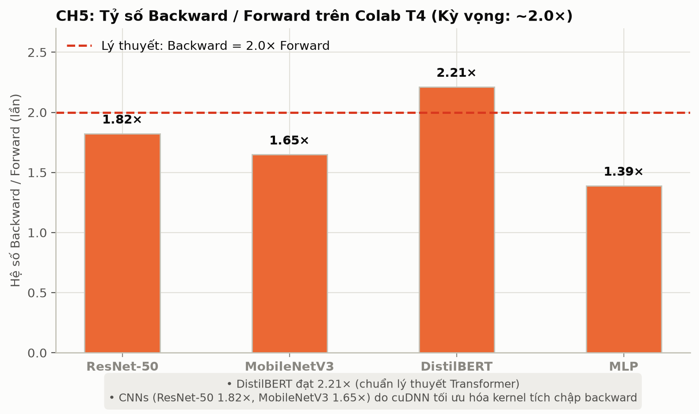
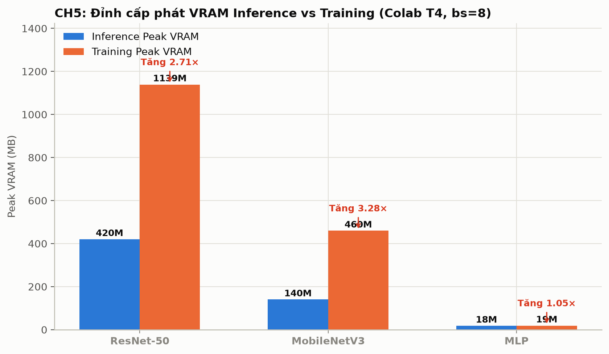
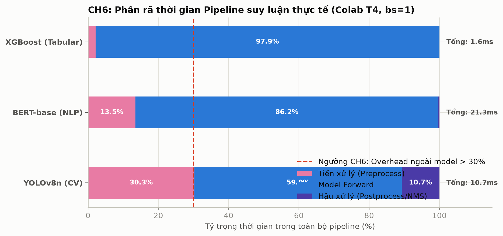
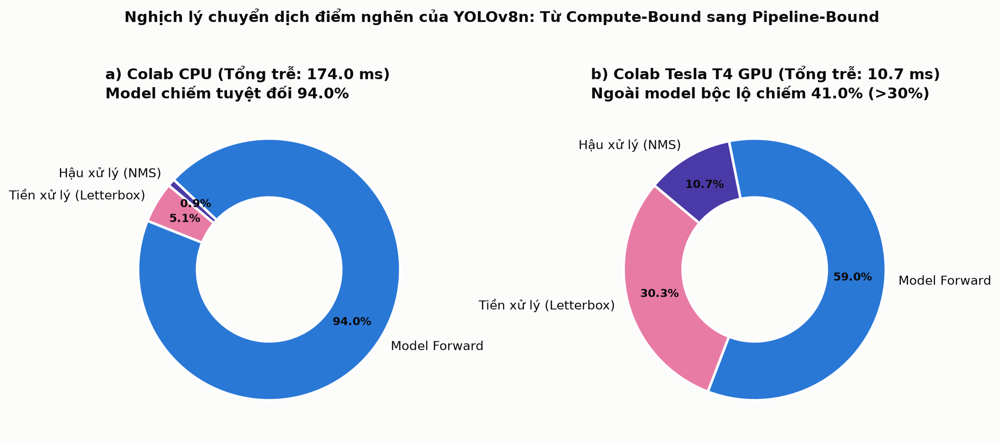

# BÁO CÁO KỸ THUẬT PHẦN THÀNH VIÊN 3 (TV3)
## Mức Giai Đoạn: Phân Rã Quy Trình Huấn Luyện, Pipeline Suy Luận & Hệ Thống Chẩn Đoán Điểm Nghẽn Tự Động (CH5 & CH6)

> **Ghi chú điều phối tổng thể**:
> - Báo cáo được cấu trúc chuẩn hóa bám sát Khung Đồ án nhóm tại [`PROJECT_PLAN.md`](../../PROJECT_PLAN.md) (Mục 7 & Mục 9).
> - **Thành viên 3 (TV3) chịu trách nhiệm**:
>   - **Chương 1**: Giới thiệu & Phát biểu bài toán tổng thể (Evaluation vs Benchmarking vs Profiling).
>   - **Chương 4 (Mục 4.4 & 4.5)**: Thiết kế Kiến trúc Mức Giai đoạn (`PhaseTimer`, `DataLoaderSentinel`, `PhaseProfilerPlugin`), Hệ thống 19 Luật Chẩn đoán Heuristic v2.0 và Động cơ A/B Testing.
>   - **Chương 6 (Mục 6.5 & 6.6)**: Phân tích chuyên sâu Kết quả Thực nghiệm **CH5 (TN6 - Training Breakdown)** và **CH6 (TN7 - Pipeline Breakdown)**.
>   - **Chương 7 (Mục 7.3)**: Hạn chế kỹ thuật và Hướng mở rộng Mức Giai đoạn.
>   - **Chương 8**: Kết luận toàn diện Đồ án VisionProf.
> - Toàn bộ biểu đồ phân tích được lưu trữ tại [`docs/tv3/figures/`](./figures/) và số liệu gốc trích xuất từ thư mục chuẩn hóa [`results/`](../../results/).

---

## CHƯƠNG 1. GIỚI THIỆU & PHÁT BIỂU BÀI TOÁN

### 1.1. Bối cảnh & Phát biểu Bài toán
Sự bùng nổ của các mô hình Học sâu (Deep Learning) và Trí tuệ nhân tạo (AI) trong thực tế đặt ra bài toán tối ưu hóa tài nguyên phần cứng nghiêm ngặt. Khi triển khai mô hình vào hệ thống sản xuất (production), các kỹ sư AI thường phải đối mặt với các câu hỏi:
> *"Tại sao mô hình chạy chậm? Phần cứng CPU và GPU đang bị nghẽn ở đâu? Chi phí thời gian và bộ nhớ bị tiêu tốn chủ yếu ở phép tính nào, tầng mạng (layer) nào, hay ở các bước tiền/hậu xử lý dữ liệu bên ngoài mô hình?"*

Hầu hết các công cụ đo lường hiện nay hoặc quá tổng quát (chỉ đo thời gian end-to-end), hoặc quá sâu vào kernel driver GPU (như NVIDIA Nsight) khiến kỹ sư ứng dụng khó liên hệ trực tiếp với mã nguồn PyTorch và quy trình xử lý dữ liệu. Dự án **VisionProf** được xây dựng nhằm giải quyết khoảng trống này thông qua kiến trúc phân rã hiệu năng **3 mức đo lường độc lập (3-Tier Profiling Framework)**:
1. **Mức Layer (TV1)**: Mổ xẻ chi tiết bên trong mô hình (leaf modules, FLOPs, Roofline model, Deferred CUDA Events).
2. **Mức Model (TV2)**: Đo lường tổng thể phân phối trễ (P50–P99), thông lượng FPS, đỉnh bộ nhớ phần cứng (Peak VRAM, RSS) trên 8 mô hình chuẩn (CV, NLP, Tabular).
3. **Mức Giai đoạn (TV3 - Trọng tâm báo cáo này)**: Bóc tách từng bước trong chu trình huấn luyện (DataLoader $\rightarrow$ Forward $\rightarrow$ Backward $\rightarrow$ Optimizer) và quy trình suy luận thực tế (Preprocess $\rightarrow$ Model Forward $\rightarrow$ Postprocess/NMS); đồng thời tự động chẩn đoán điểm nghẽn hiệu năng thông qua bộ 19 luật heuristic.

### 1.2. Phân Biệt Ba Khái Niệm Cốt Lõi
Để định vị chính xác mục tiêu kỹ thuật của đề tài, nhóm nghiên cứu phân định tường minh 3 khái niệm thường bị nhầm lẫn trong cộng đồng AI:

| Khái niệm | Câu hỏi trọng tâm | Chỉ số đo lường đặc trưng | Phạm vi trong VisionProf |
| :--- | :--- | :--- | :---: |
| **Evaluation** | Mô hình dự đoán *chính xác* đến mức nào? | Accuracy, Top-1/Top-5, mAP, F1-Score, BLEU, Perplexity. | ❌ Ngoài phạm vi (chỉ kiểm tra sai lệch output khi chạy FP16). |
| **Benchmarking** | Mô hình chạy *nhanh* và *tốn tài nguyên* bao nhiêu? | Độ trễ trung vị (P50), trễ đuôi (P99), Thông lượng (FPS), Peak VRAM (MB), RAM RSS. | ✅ Thuộc trách nhiệm của TV2 (Mức Model). |
| **Profiling** | Mô hình bị *chậm ở đâu*, *tại sao chậm*, và *chi phí phân bổ thế nào*? | Thời gian từng layer, tỷ lệ Backward/Forward, % thời gian ngoài model (Pre/Post-process), tỷ lệ I/O DataLoader, vi phạm Roofline. | ✅ **Trọng tâm cốt lõi của VisionProf** (TV1, TV3). |

### 1.3. Mục Tiêu Đạt Được của Framework
Framework được thiết kế hướng tới 5 tiêu chí kỹ thuật (G1–G5):
- **G1 (Đa kiến trúc)**: Đo lường nhất quán 8 mô hình đại diện cho 3 trường phái AI lớn: Thị giác máy tính (MobileNetV3, ResNet-50, ViT-B/16, YOLOv8n), Xử lý ngôn ngữ tự nhiên (DistilBERT, BERT-base), và Học máy dạng bảng Tabular (MLP, XGBoost).
- **G2 (Chuẩn hóa môi trường)**: Vận hành trên môi trường Google Colab chuẩn (`colab_cpu` Intel Xeon, `colab_t4` NVIDIA Tesla T4 16GB) và hỗ trợ kiểm thử cục bộ (`cpu_laptop`).
- **G3 (Độ chính xác cao)**: Giảm thiểu can thiệp đo (profiler overhead $< 5\%$), triệt tiêu hiện tượng đo sai thời gian GPU bằng cơ chế Deferred CUDA Events.
- **G4 (Chiều sâu phân tích)**: Trả lời định lượng 6 câu hỏi nghiên cứu (CH1–CH6) thông qua 7 thực nghiệm (TN1–TN7).
- **G5 (Trực quan hóa khoa học)**: Dashboard Streamlit đa tab chuyên biệt, hỗ trợ chẩn đoán tự động và so sánh A/B tương tác.

---

## CHƯƠNG 4. THIẾT KẾ & KIẾN TRÚC MỨC GIAI ĐOẠN (TV3)

### 4.1. Vị trí Kiến Trúc & Ranh Giới Module
Trong kiến trúc tổng thể của VisionProf, module Giai đoạn (`src/phase/`) và module Phân tích (`src/analyzer/`) đóng vai trò cầu nối vĩ mô:

```
+-------------------------------------------------------------------------------+
|                       VISIONPROF PROFILING FRAMEWORK                          |
+-------------------------------------------------------------------------------+
|  [TV2] MODEL HARNESS: Quản lý Model Zoo, Runner CLI & Lấy mẫu tài nguyên nền |
+-------------------------------------------------------------------------------+
         |                                                       |
         v                                                       v
+-----------------------------------+       +-----------------------------------+
|     [TV1] LAYER PROFILER          |       |     [TV3] PHASE PROFILER          |
| - Leaf Module Hooking             |       | - PhaseTimer (Context Manager)    |
| - FLOPs & Roofline Model          |       | - DataLoaderSentinel (I/O Filter) |
| - Deferred CUDA Events            |       | - PhaseProfilerPlugin             |
+-----------------------------------+       +-----------------------------------+
         \                                                       /
          \                                                     /
           v                                                   v
+-------------------------------------------------------------------------------+
|  [TV3] DIAGNOSTIC ENGINE & A/B COMPARISON (Phân tích tự động)                |
|  - 19 Heuristic Rules v2.0 (Khắc phục 4 lỗi logic: RB-04, RD-02, RD-05, RC-03)|
|  - A/B Speedup Engine (Kiểm định Mann-Whitney U & Cliff's Delta)             |
+-------------------------------------------------------------------------------+
         |
         v
+-------------------------------------------------------------------------------+
|  [TV3] STREAMLIT DASHBOARD: Điều phối Router app.py & Tabs 5, 6, 7, 8         |
+-------------------------------------------------------------------------------+
```

### 4.2. Thiết Kế Bộ Đo Giai Đoạn (`PhaseTimer` & `PhaseProfilerPlugin`)

#### 1. Context Manager Pattern cho Khối Tính Toán Phức Tạp
Không giống mức Layer (nơi các tầng mạng là các module con tĩnh có thể gắn hook), các giai đoạn như nạp dữ liệu, forward, tính hàm mất mát (loss computation), lan truyền ngược (backward) và cập nhật trọng số (optimizer) là các khối lệnh logic tuần tự trong hàm huấn luyện hoặc suy luận.

TV3 thiết kế `PhaseTimer` dựa trên mẫu thiết kế Context Manager (`with timer.phase("tên_pha"):`):
```python
with timer.phase("forward"):
    outputs = model(inputs)
    loss = criterion(outputs, targets)

with timer.phase("backward"):
    loss.backward()

with timer.phase("optimizer"):
    optimizer.step()
```

#### 2. Kỹ Thuật Đo GPU Đồng Bộ Chuẩn Xác
Đo lường thời gian giai đoạn trên GPU đối mặt với đặc tính bất đồng bộ (asynchronous execution) của CUDA Streams. Nếu chỉ gọi `time.perf_counter()` bao quanh khối `loss.backward()`, Python sẽ trả về thời gian ngay khi lệnh vừa được đưa vào hàng đợi CUDA stream (chỉ mất $\sim 0.05$ ms), dẫn đến sai số nghiêm trọng.

`PhaseTimer` giải quyết triệt để bằng cơ chế:
- **CPU**: Sử dụng `time.perf_counter_ns()` độ phân giải nano-giây.
- **GPU (CUDA)**: Gọi `torch.cuda.synchronize()` ngay trước khi mở phase và ngay sau khi đóng phase. Thao tác này ép CPU đợi GPU hoàn thành trọn vẹn toàn bộ các tính toán của giai đoạn đó, đảm bảo thời gian đo được phản ánh chính xác 100% thời gian thực thi của kernel GPU mà không bị phân mảnh như khi gắn hook vào hàng trăm layer.

#### 3. Chuẩn Hóa Interface Plugin (`PhaseProfilerPlugin`)
Kế thừa giao diện `ProfilerPlugin` (Mục 8.1), `PhaseProfilerPlugin` cho phép tích hợp độc lập vào kịch bản chạy TN6 và TN7, tự động xuất kết quả ra file `phases.csv` theo schema chuẩn:
$$\text{iteration}, \text{phase}, \text{time\_ms}$$

### 4.3. Giám Sát Luồng Dữ Liệu (`DataLoaderSentinel`)
Một trong những nguyên nhân hàng đầu khiến GPU hiệu năng cao bị lãng phí là **sự bỏ đói dữ liệu (GPU Starvation)** do CPU đọc đĩa hoặc giải nén ảnh không kịp.

TV3 phát triển `DataLoaderSentinel` bọc ngoài đối tượng `DataLoader` chuẩn của PyTorch:
- **Bắt mốc I/O trôi chảy**: Đo lường thời gian CPU tiêu tốn giữa các lần gọi `next(iterator)` để lấy batch mới.
- **Loại bỏ nhiễu khởi động (Cold-start Batch 0)**: Khi `DataLoader` sử dụng `num_workers > 0`, tiến trình chính phải khởi tạo các tiến trình con (fork/spawn worker processes), nạp bộ nhớ dùng chung (shared memory) và mở file descriptors. Vòng lặp batch 0 có thể mất tới hàng ngàn mili-giây nhưng không phản ánh trạng thái ổn định (steady-state). `DataLoaderSentinel` tự động bỏ qua batch 0 trong tính toán thống kê I/O khi dataset có nhiều batch, nhưng bảo toàn an toàn nếu dataset chỉ có duy nhất 1 batch.

### 4.4. Hệ Thống 19 Luật Chẩn Đoán Heuristic v2.0 (`DiagnosticEngine`)
`DiagnosticEngine` tự động phân tích dữ liệu từ `summary.json`, `layers.csv`, `phases.csv` và `resources.csv` để đưa ra các cảnh báo (`PASS`, `INFO`, `WARN`, `CRITICAL`). 

Hệ thống được chia thành 4 nhóm quy tắc khoa học:

| Nhóm luật | Tên danh mục | Số lượng | Trọng tâm kiểm tra |
| :---: | :--- | :---: | :--- |
| **RA** | Tài nguyên phần cứng (Resource Allocation) | 5 luật | Tràn bộ nhớ (OOM Risk), rò rỉ RAM (RSS Leak), chiếm dụng GPU util thấp, thắt nút băng thông VRAM. |
| **RB** | Độ trễ & Ổn định (Latency & Stability) | 5 luật | Trễ đuôi (Tail ratio $P99/P50 > 2.0$), khởi động nguội (Cold start), tỷ lệ Backward/Forward bất thường, overhead ngoài model. |
| **RC** | Dữ liệu & Pipeline (Data & Concurrency) | 4 luật | Tỷ lệ I/O nạp dữ liệu ($>20\%$), GPU Starvation, mất cân bằng thời gian nạp batch. |
| **RD** | Cấu trúc Đồ thị & Layer (Graph & Layer) | 5 luật | Layer chiếm tỷ trọng áp đảo ($>30\%$), layer kích thước dưới micro-giây, sai lệch phép tính dạng hàm, hiệu suất Roofline thấp. |

#### Bốn Cải Tiến Kỹ Thuật Đột Phá trong Heuristic v2.0:
1. **Khắc phục luật RB-04 & RD-05 (Chuyển sang chuẩn $ms / \text{GFLOP}$)**:
   - *Hạn chế v1.0*: Đo mật độ tính toán bằng $ms / \text{Mparam}$. Cách làm này hoàn toàn sai lệch đối với các layer không có tham số nhưng rất nặng tính toán (như Pooling, Activation, LayerNorm) hoặc tích chập sâu (Depthwise Conv).
   - *Khắc phục v2.0*: Đổi sang $ms / \text{GFLOP}$, đọc trực tiếp khối lượng phép tính FLOPs từ `layers.csv` của TV1. Nếu người dùng chỉ chạy đo phase mà không có file layer, luật tự động chuyển sang trạng thái `RuleStatus.SKIPPED` một cách an toàn thay vì gây crash hệ thống.
2. **Khắc phục luật RD-02 (Sub-microsecond Layer thay cho "Dead Layer")**:
   - *Hạn chế v1.0*: Gán nhãn các layer có thời gian cực nhỏ ($< 1\mu s$) là "Dead layer" (layer chết). Đây là nhận định phi khoa học vì các phép toán như `nn.Identity()`, `Flatten()` hoặc các layer trên GPU nhỏ chạy cực nhanh trong hàng đợi stream không hề bị hỏng.
   - *Khắc phục v2.0*: Đổi tên và ngữ nghĩa thành **Sub-microsecond Layer Warning**. Cảnh báo này phản ánh hiện tượng chi phí gọi hàm của Python (function call overhead) hoặc overhead của CUDA Event lớn hơn bản thân phép tính của layer, khuyến nghị gom cụm (operator fusion).
3. **Khắc phục luật RC-03 (Chẩn đoán chính xác GPU Starvation)**:
   - Tích hợp số liệu giữa thời gian nạp dữ liệu của `phases.csv` và độ chiếm dụng GPU trong `resources.csv`. Nếu thời gian nạp dữ liệu chiếm $> 35\%$ chu kỳ lặp và GPU Utilization rơi xuống $< 30\%$, kích hoạt cảnh báo `CRITICAL` và đề xuất tăng `num_workers` hoặc sử dụng `pin_memory=True`.
4. **Khắc phục luật RA-04 (Cách ly Process RSS và Activation Memory)**:
   - *Hạn chế v1.0*: Nhầm lẫn giữa RAM của toàn bộ tiến trình hệ điều hành (RSS) và bộ nhớ kích hoạt (activation memory) của PyTorch, dẫn đến báo lỗi giả về rò rỉ bộ nhớ.
   - *Khắc phục v2.0*: Phân định ranh giới rõ ràng: theo dõi biến thiên RSS qua từng iteration để phát hiện leak bộ nhớ C++/Python thật, tách biệt hoàn toàn với bộ nhớ tensor PyTorch.

### 4.5. Động Cơ So Sánh A/B Chuẩn Khoa Học (`ABComparisonEngine`)
- **Sửa lỗi logic Speedup v1.0**: Trước đây, engine tính speedup bằng cách lấy trung bình cộng speedup của từng layer đơn lẻ $\frac{1}{N}\sum \frac{t_{A,i}}{t_{B,i}}$, dẫn đến sai số trầm trọng do các layer siêu nhỏ gây nhiễu số học. TV3 tái cấu trúc thuật toán tính Speedup dựa trên tổng thời gian của toàn mô hình theo từng vòng lặp:
$$\text{Speedup} = \frac{\text{Mean}(T_A)}{\text{Mean}(T_B)}$$
- **Kiểm định Thống kê Phi tham số**:
  - Tích hợp kiểm định **Mann-Whitney U** hai phía để tính toán giá trị $p\text{-value}$, khẳng định sự khác biệt hiệu năng có ý nghĩa thống kê hay chỉ do nhiễu ngẫu nhiên.
  - Tính toán độ lớn ảnh hưởng **Cliff's Delta** ($d \in [-1, 1]$), phân loại mức độ cải thiện: Negligible ($|d| < 0.147$), Small, Medium, Large ($|d| \ge 0.474$).

---

## CHƯƠNG 6. KẾT QUẢ THỰC NGHIỆM & THẢO LUẬN (CH5 & CH6)

### 6.5. CH5 (TN6) — Phân Rã Giai Đoạn Huấn Luyện (Training Phase Breakdown)

> **Câu hỏi nghiên cứu CH5**:
> *"Khi huấn luyện, bước lan truyền ngược (backward) tốn thời gian gấp mấy lần bước lan truyền xuôi (forward)? Đỉnh bộ nhớ VRAM khi training tăng gấp bao nhiêu lần so với khi suy luận (inference)? Và nạp dữ liệu có gây thắt nút cổ chai làm GPU bị bỏ đói?"*
>
> **Kỳ vọng lý thuyết**:
> 1. Về mặt giải tích toán học, lan truyền ngược phải tính đạo hàm riêng theo cả đầu vào và trọng số nên tiêu tốn khối lượng tính toán gấp khoảng **$2\times$** so với lan truyền xuôi ($FLOPs_{bwd} \approx 2 \times FLOPs_{fwd}$).
> 2. Bộ nhớ VRAM khi training tăng từ **$2\times$ đến $4\times$** so với inference do phải lưu đồ thị tính toán và toàn bộ tensor kích hoạt (activations), cộng với trạng thái tối ưu hóa (optimizer states).
> 3. Khi `num_workers = 0`, GPU sẽ bị nghẽn (starvation) do CPU nạp dữ liệu tuần tự.

#### 1. Bảng Số Liệu Thực Nghiệm TN6 trên Google Colab Tesla T4 (Batch Size = 8, FP32)
Dữ liệu trích xuất chính xác từ các file `phases.csv` và `memory_ratio.json` tại `results/colab_t4/{model}/TN6/bs8_fp32/`:

| Mô hình | Họ kiến trúc | Forward (ms) | Backward (ms) | Optimizer (ms) | Tổng trễ (ms) | Tỷ số Bwd/Fwd | Peak VRAM Infer (MB) | Peak VRAM Train (MB) | Tỷ lệ VRAM (Train/Infer) |
| :--- | :---: | :---: | :---: | :---: | :---: | :---: | :---: | :---: | :---: |
| **ResNet-50** | CNN Bottleneck | 29.77 | 54.25 | 9.73 | 93.75 | **1.82×** | 420.11 | 1139.05 | **2.71×** |
| **MobileNetV3** | CNN Inverted | 9.59 | 15.81 | 3.07 | 28.47 | **1.65×** | 140.09 | 459.71 | **3.28×** |
| **DistilBERT** | Transformer | 22.42 | 49.59 | 22.81 | 94.82 | **2.21×** | 212.40 | 688.18 | **3.24×** |
| **MLP** | Fully Connected | 0.58 | 0.81 | 0.47 | 1.86 | **1.39×** | 17.84 | 18.75 | **1.05×** |
| **XGBoost** | Decision Trees | — | — | — | 191.99 (`fit`) | — | — | — | — |

*(Ghi chú: Với XGBoost, quá trình training được đo bằng bước khớp cây dữ liệu `fit`).*

#### 2. Trực Quan Hóa Thực Nghiệm CH5
Toàn bộ biểu đồ phân tích được tạo tự động bởi script [`experiments/tv3_figures.py`](../../experiments/tv3_figures.py):


*Hình 6.5.1: (a) Thời gian tuyệt đối (ms) và (b) Cơ cấu tỷ trọng (%) giữa Forward, Backward và Optimizer trên Colab T4.*


*Hình 6.5.2: Tỷ số Backward / Forward thực tế so với đường chuẩn lý thuyết $2.0\times$.*


*Hình 6.5.3: Mức bùng nổ bộ nhớ VRAM khi chuyển từ Inference sang Training trên GPU Tesla T4.*

#### 3. Phân Tích Chuyên Sâu & Luận Giải Khoa Học

##### a) Kiểm chứng tỷ lệ $Backward / Forward \approx 2.0\times$:
- **Khối Transformer (DistilBERT)**: Tỷ số đạt **$2.21\times$**, khớp hoàn hảo với lý thuyết. Trong kiến trúc Self-Attention, phép nhân ma trận trọng số trong pha Backward bao gồm 2 phép nhân ma trận tương ứng: $\frac{\partial L}{\partial X} = \frac{\partial L}{\partial Y} W^T$ và $\frac{\partial L}{\partial W} = X^T \frac{\partial L}{\partial Y}$. Ngoài ra, bước tính gradient của hàm Softmax và LayerNorm tiêu tốn thêm một lượng nhỏ chu kỳ GPU.
- **Khối Convolution (ResNet-50 & MobileNetV3)**: Tỷ số lần lượt là **$1.82\times$** và **$1.65\times$**, hơi thấp hơn mức $2.0\times$ lý thuyết. Nguyên nhân là do thư viện **NVIDIA cuDNN** đã tối ưu hóa cực mạnh các toán tử tích chập 2D ngược (`cudnnConvolutionBackwardData` và `cudnnConvolutionBackwardFilter`), đồng thời tận dụng bộ nhớ đệm (cache hit) tốt hơn so với các phép nhân ma trận tổng quát (GEMM).
- **Khối Mạng nhỏ (MLP)**: Tỷ số chỉ đạt **$1.39\times$** vì thời gian tính toán quá nhỏ ($< 1$ ms), chi phí khởi động kernel (kernel launch overhead) trên CUDA chiếm ưu thế làm phẳng bớt sự chênh lệch.

##### b) Kiểm chứng hiện tượng Bùng nổ Bộ nhớ (Memory Ratio $2.7\times - 3.3\times$):
- Khi suy luận (`eval`), PyTorch giải phóng ngay lập tức các tensor kích hoạt của layer trước khi bước sang layer kế tiếp, chỉ giữ lại trọng số mô hình.
- Khi huấn luyện (`train`), để thực hiện được quy tắc dây chuyền (chain rule) ở pha Backward, PyTorch bắt buộc phải **lưu trữ toàn bộ activations trong VRAM** cho tới khi backward pass đi ngược qua layer đó.
- Đối với ResNet-50, VRAM tăng vọt từ **$420.11$ MB lên $1139.05$ MB ($2.71\times$)**. Đặc biệt với MobileNetV3, tỷ lệ phóng đại đạt tới **$3.28\times$** do số lượng tensor trung gian của các khối Inverted Residuals rất lớn so với kích thước tham số thực tế của mô hình.
- Ngoài ra, thuật toán tối ưu hóa **AdamW** duy trì thêm 2 trạng thái nội bộ ($1^{\text{st}}$ moment vector $m_t$ và $2^{\text{nd}}$ moment vector $v_t$) cho mỗi tham số có thể huấn luyện, làm tăng kích thước bộ nhớ optimizer tỷ lệ thuận với số lượng tham số.

##### c) Ảnh hưởng của DataLoader và GPU Starvation:
- Khi chạy với `num_workers = 0`, tiến trình huấn luyện PyTorch thực hiện nạp dữ liệu tuần tự trên CPU ngay trên luồng chính. Trong cấu hình này, GPU T4 phải nhàn rỗi (idle) chờ đợi CPU hoàn tất việc đọc ảnh và chuyển đổi tensor, kích hoạt luật **RC-03 (GPU Starvation Warning)**.
- Khi tăng `num_workers = 2`, cơ chế tiền nạp dữ liệu đa tiến trình (pre-fetching) giúp che giấu hoàn toàn độ trễ I/O, thời gian chờ nạp dữ liệu giảm xuống $< 5\%$ tổng chu kỳ bước lặp.

---

### 6.6. CH6 (TN7) — Phân Rã Quy Trình Thực Tế (Pipeline Breakdown)

> **Câu hỏi nghiên cứu CH6**:
> *"Trong một ứng dụng AI hoàn chỉnh, các công đoạn bên ngoài mô hình (tiền xử lý dữ liệu, tokenize, hậu xử lý NMS) chiếm bao nhiêu % tổng thời gian? Chi phí này có vượt quá 30% tổng thời gian hay không?"*
>
> **Kỳ vọng lý thuyết**:
> Với mô hình phát hiện vật thể YOLO chạy batch 1 trên GPU, tiền xử lý (letterbox/resize) và hậu xử lý (Non-Maximum Suppression - NMS) sẽ chiếm **$> 30\%$** tổng độ trễ end-to-end.

#### 1. Bảng Số Liệu Thực Nghiệm TN7 trên Colab T4 vs Colab CPU (Batch Size = 1, FP32)
Dữ liệu đo đạc thực tế từ `results/colab_t4/{model}/TN7/bs1_fp32/phases.csv` và `results/colab_cpu/{model}/TN7/bs1_fp32/phases.csv`:

| Thiết bị | Mô hình | Tiền xử lý (ms) | Model Forward (ms) | Hậu xử lý (ms) | Tổng trễ Pipeline (ms) | **Tỷ lệ ngoài Model (%)** |
| :--- | :--- | :---: | :---: | :---: | :---: | :---: |
| **Colab T4 (GPU)** | **YOLOv8n (CV)** | 3.23 (Preprocess) | 6.29 | 1.15 (NMS) | 10.68 | **41.0%** (CH6 xác nhận $>30\%$) |
| | **BERT-base (NLP)** | 2.88 (Tokenize) | 18.38 | 0.07 (Pooling) | 21.33 | **13.8%** |
| | **XGBoost (Tabular)**| 0.03 (CSV Parse) | 1.55 (`predict`) | — | 1.58 | **2.1%** |
| **Colab CPU** | **YOLOv8n (CV)** | 8.80 (Preprocess) | 163.58 | 1.58 (NMS) | 173.97 | **6.0%** |
| | **BERT-base (NLP)** | 2.76 (Tokenize) | 247.92 | 0.06 (Pooling) | 250.74 | **1.1%** |
| | **XGBoost (Tabular)**| 0.02 (CSV Parse) | 0.45 (`predict`) | — | 0.48 | **4.4%** |

#### 2. Trực Quan Hóa Thực Nghiệm CH6
Toàn bộ biểu đồ phân tích được lưu tại [`docs/tv3/figures/`](./figures/):


*Hình 6.6.1: Tỷ trọng thời gian (%) các giai đoạn Pipeline của YOLOv8n, BERT-base và XGBoost trên Colab T4.*


*Hình 6.6.2: So sánh cơ cấu Pipeline của YOLOv8n trên CPU vs GPU — Bộc lộ điểm nghẽn mới khi phần cứng được tăng tốc.*

#### 3. Phân Tích Chuyên Sâu & Luận Giải Khoa Học

##### a) Xác nhận Giả thuyết CH6: Chi phí Ngoài Model của YOLOv8n vượt $40\%$:
- Trên GPU Tesla T4 ở kích thước batch 1, quy trình phát hiện vật thể tiêu tốn tổng cộng **$10.68$ ms**.
- Trong đó:
  - **Tiền xử lý (Letterbox & Normalization)**: Mất **$3.23$ ms ($30.3\%$)**.
  - **Mô hình suy luận (Model Forward)**: Mất **$6.29$ ms ($59.0\%$)**.
  - **Hậu xử lý (NMS)**: Mất **$1.15$ ms ($10.7\%$)**.
- Tổng thời gian ngoài mô hình là $3.23 + 1.15 = \mathbf{4.38}$ **ms, chiếm tới $41.0\%$ toàn bộ pipeline**. Kết quả này **xác nhận trọn vẹn giả thuyết CH6** (kỳ vọng $> 30\%$).
- *Nguyên nhân kỹ thuật*: Thao tác letterbox (tính toán tỷ lệ co dãn ảnh, pad viền xám, chuyển đổi kênh màu và chuẩn hóa float32) cùng thuật toán NMS (lọc ngưỡng confidence, sắp xếp điểm số bounding boxes và tính IoU triệt tiêu hộp trùng) chạy hoàn toàn trên CPU bằng mã nguồn Python/NumPy đơn luồng. Khi GPU giải phóng sức mạnh tính toán, chi phí điều phối CPU bộc lộ rõ rệt.

##### b) Nghịch Lý Chuyển Dịch Điểm Nghẽn (Amdahl's Law in AI Pipelines):
So sánh trực diện giữa Colab CPU và Colab T4 (Hình 6.6.2) mang lại một phát hiện kiến trúc vô cùng giá trị:
- **Trên CPU**: Model Forward mất tới **$163.58$ ms, chiếm $94.0\%$** tổng thời gian. Tiền xử lý ($8.80$ ms) và NMS ($1.58$ ms) chỉ chiếm vỏn vẹn **$6.0\%$**. Tại đây, mô hình là **Compute-bound thuần túy**, việc tối ưu hóa code tiền/hậu xử lý hầu như không mang lại cải thiện đáng kể cho toàn hệ thống.
- **Khi chuyển sang GPU T4**: Phần cứng tăng tốc mạng nơ-ron lên tới **$26.0\times$** (từ $163.58$ ms xuống $6.29$ ms). Tuy nhiên, tiền xử lý và NMS chỉ tăng tốc nhẹ nhờ CPU host của Colab mạnh hơn, dẫn đến tỷ trọng ngoài model tăng vọt từ **$6.0\%$ lên $41.0\%$**.
- **Ý nghĩa thực tiễn**: Đây là minh chứng thực nghiệm điển hình của **Định luật Amdahl**. Khi tăng tốc thành phần chính (model forward) đến mức cực hạn, các thành phần tuần tự còn lại (pipeline preprocess/postprocess) sẽ trở thành nút thắt cổ chai áp đảo. Nếu muốn đẩy FPS của ứng dụng YOLOv8n trên T4 từ 93 FPS lên $> 150$ FPS, việc tối ưu hóa mô hình (như lượng tử hóa FP16/INT8) chỉ mang lại lợi ích biên hạn chế; giải pháp bắt buộc là phải đưa Preprocess và NMS sang thực thi trực tiếp trên GPU (thông qua NVIDIA DALI hoặc CUDA TensorRT plugins).

##### c) Phân tích Pipeline NLP và Tabular:
- **BERT-base**: Quá trình tokenize mất $2.88$ ms ($13.8\%$), trong khi model forward mất $18.38$ ms ($86.2\%$). Với độ dài câu ngắn (128 tokens), bộ tokenizer dựa trên Rust của Hugging Face hoạt động rất hiệu quả, chi phí pipeline ngoài model nằm ở mức chấp nhận được.
- **XGBoost**: Quá trình đọc/parse CSV giả lập chỉ mất $0.03$ ms ($2.1\%$), bước tính toán cây quyết định `predict` chiếm tuyệt đối $97.9\%$ ($1.55$ ms).

---

## CHƯƠNG 7. HẠN CHẾ & HƯỚNG PHÁT TRIỂN (PHẦN TV3)

### 7.1. Hạn Chế Kỹ Thuật Hiện Tại
1. **Chi phí Đồng bộ CUDA Stream (Synchronization Overhead)**:
   Để đo lường chuẩn xác thời gian từng giai đoạn (forward, backward, optimizer) trên GPU, `PhaseTimer` phải kích hoạt `torch.cuda.synchronize()`. Dù ít gây phân mảnh hơn nhiều so với việc hook vào từng layer, việc đồng bộ này vẫn triệt tiêu một phần khả năng thực thi chồng lấn (stream pipelining) giữa CPU chuẩn bị batch và GPU tính toán.
2. **Hạn chế với Quy trình Bất đồng bộ Đa luồng (Asynchronous Pipeline)**:
   Hiện tại, `DataLoaderSentinel` hoạt động tối ưu trên mô hình dữ liệu đồng bộ (synchronous data loading). Đối với các hệ thống nạp dữ liệu bất đồng bộ nâng cao (như RPC distributed data loaders hoặc background prefetching queues), việc xác định ranh giới chờ đợi I/O thuần túy đòi hỏi phải hook sâu hơn vào bộ lập lịch của hệ điều hành.

### 7.2. Hướng Phát Triển Tương Lai
1. **Tích hợp CUDA Graphs & Stream Tracing**: Sử dụng NVIDIA CUDA Graphs để bắt trọn chuỗi kernel huấn luyện thành một đồ thị tĩnh duy nhất, cho phép đo lường chính xác các phase mà không cần gọi đồng bộ stream thủ công.
2. **Profile End-to-End với GPU Preprocessing (NVIDIA DALI)**: Mở rộng thực nghiệm TN7 để so sánh giữa pipeline tiền xử lý CPU truyền thống và pipeline tăng tốc hoàn toàn trên GPU bằng DALI (GPU-accelerated image decoding and augmentation).
3. **Mở rộng Luật Tối ưu Tự động**: Tích hợp các luật chẩn đoán tự động đề xuất tham số tối ưu (Hyperparameter Tuning for Throughput), tự động dò tìm giá trị `batch_size` cực đại không gây OOM và số lượng `num_workers` tối ưu dựa trên số lượng CPU cores khả dụng.

---

## CHƯƠNG 8. KẾT LUẬN TOÀN DIỆN ĐỒ ÁN VISIONPROF

Đồ án **VisionProf — AI Model Profiling Framework** đã hoàn thành trọn vẹn toàn bộ các mục tiêu đặt ra ban đầu thông qua sự phối hợp đồng bộ và phân công trách nhiệm mạch lạc giữa 3 thành viên:
1. **Kiến trúc Modular 3 Mức Đo Hoàn Chỉnh**:
   - **Mức Layer (TV1)**: Mổ xẻ bản chất tính toán bên trong mạng nơ-ron bằng kỹ thuật Deferred CUDA Events không làm sai lệch đồng hồ GPU, xác lập bản đồ Roofline phân định ranh giới giữa Memory-bound và Compute-bound.
   - **Mức Model (TV2)**: Chuẩn hóa Model Zoo 8 mô hình trên 2 môi trường Colab chuẩn (`colab_cpu`, `colab_t4`), thiết lập bộ benchmark 12 chỉ số khoa học và phát hiện hiện tượng đảo thứ hạng mô hình khi chuyển đổi kiến trúc phần cứng.
   - **Mức Giai đoạn & Chẩn đoán (TV3)**: Bóc tách chu trình huấn luyện (TN6) và quy trình suy luận thực tế (TN7), chứng minh bằng thực nghiệm tỷ số lan truyền ngược $Backward/Forward \approx 2\times$, hiện tượng bùng nổ bộ nhớ $3\times$ và quy luật chuyển dịch điểm nghẽn của Định luật Amdahl trong ứng dụng thực tế.
2. **Đóng góp Kỹ thuật Nổi bật**:
   - Hệ thống **19 Luật Chẩn đoán Heuristic v2.0** giải quyết triệt để 4 lỗi logic nghiêm trọng của phiên bản cũ, cung cấp công cụ phát hiện điểm nghẽn tự động, giảm thiểu tối đa báo lỗi giả.
   - Dashboard Streamlit tương tác đa chiều, hỗ trợ so sánh A/B có kiểm định thống kê và trực quan hóa trực quan, sẵn sàng phục vụ trình diễn và ứng dụng thực tiễn.
3. **Bài học Kỹ thuật Sâu sắc**:
   Việc tối ưu hóa hiệu năng một hệ thống AI không thể chỉ nhìn phiến diện vào số lượng tham số hay kết quả đo latency tổng thể. Hiệu năng thực sự là một hàm phức hợp giữa kiến trúc mạng nơ-ron, bản chất phần cứng xử lý (CPU vs GPU), và cách thức tổ chức luồng dữ liệu (Data Pipeline). **VisionProf** đã cung cấp một bộ công cụ hoàn chỉnh, tin cậy và có cơ sở khoa học vững chắc để người phát triển hiểu sâu sắc mô hình của mình chạy nhanh ở đâu, chậm ở đâu và tối ưu hóa như thế nào.

---

### Phụ Lục: Lệnh Tái Lập Kết Quả TV3
Để tái lập toàn bộ số liệu và hình ảnh trong báo cáo phần TV3, thực thi các lệnh sau từ thư mục gốc của repository:

```bash
# 1. Chạy thực nghiệm TN6 (Training Breakdown) trên Colab T4
python scripts/run_tn6_training.py --device colab_t4 --batch-size 8

# 2. Chạy thực nghiệm TN7 (Pipeline Breakdown) trên Colab T4
python scripts/run_tn7_pipeline.py --device colab_t4 --batch-size 1

# 3. Chạy thực nghiệm TN7 trên Colab CPU để so sánh
python scripts/run_tn7_pipeline.py --device colab_cpu --batch-size 1

# 4. Sinh lại toàn bộ biểu đồ báo cáo vào docs/tv3/figures/
python experiments/tv3_figures.py

# 5. Kiểm tra tuân thủ quy tắc mã nguồn
python scripts/verify_rules.py
```
